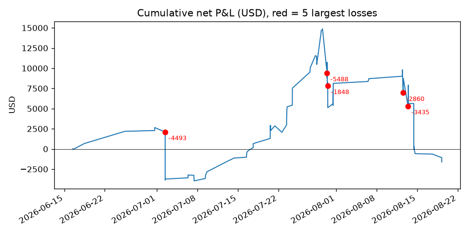

# 交易史报告（第二轮）

生成：2026-10-22T00:56:46+00:00 UTC · 往返 157 笔（全部为多头期权），未配对单边 37 笔不计入 · 耗时 23s

## 1. 累计净盈亏



合计 -1619.59 USD；累计曲线最大回撤 -16497.49 USD。最大 5 笔亏损：

| symbol | entry_et | exit_et | hold_min | qty | entry_px | exit_px | pnl_net |
|---|---|---|---|---|---|---|---|
| MU260731P810000.US | 2026-07-30 09:45 | 2026-07-30 10:30 | 45 | 4 | 21.95 | 8.25 | -5487.94 |
| DRAM260717C75000.US | 2026-06-29 09:30 | 2026-07-02 10:33 | 4383 | 14 | 4.45 | 1.26 | -4493.49 |
| MU260814P935000.US | 2026-08-13 09:53 | 2026-08-13 10:32 | 39 | 5 | 17 | 10.15 | -3434.94 |
| MU260814P920000.US | 2026-08-12 11:46 | 2026-08-12 13:53 | 127 | 5 | 19.5 | 13.8 | -2859.98 |
| MU260731P860000.US | 2026-07-30 13:04 | 2026-07-30 13:18 | 14 | 4 | 25 | 20.4 | -1848.04 |

这 5 笔合计 -18124.39 USD，占全部亏损的 44.2%。

## 2. 最长连续盈利区间

按出场时间排序，最长连胜 12 笔：2026-07-16 12:02 ～ 2026-07-20 15:20，合计 4055.54 USD。
价外程度 otm_pct：>0 为价外（call 行权价高于现价、put 低于现价），用入场分钟的正股收盘价；day_ret / day_rv 为入场当日标的开盘→收盘涨跌与 1 分钟收益年化波动。无正股 K 的标的（DRAM 等）不计入这三列。DTE 均值被少数 2027-01 长期合约拉高，看中位数。

| group | trips | dte_mean | dte_median | dte0_share | hold_min_median | qty_mean | otm_pct_median | day_ret_median_pct | day_rv_median | call_share | top_session |
|---|---|---|---|---|---|---|---|---|---|---|---|
| 最长连胜 | 12 | 2.33 | 1.5 | 0 | 14.7 | 1.33 | 0.52 | -1.57 | 0.88 | 0 | 11:30–14:00 |
| 其余 | 145 | 20.84 | 1 | 0.16 | 10.5 | 2.82 | 0.24 | -0.18 | 0.89 | 0.48 | 10:00–11:30 |
| 全部 | 157 | 19.43 | 1 | 0.15 | 10.5 | 2.71 | 0.32 | -0.18 | 0.89 | 0.44 | 10:00–11:30 |

入场时段分布（行内占比）：

| group | 09:30–10:00 | 10:00–11:30 | 11:30–14:00 | 14:00–15:30 | 15:30–16:00 |
|---|---|---|---|---|---|
| 其余 | 0.17 | 0.41 | 0.28 | 0.1 | 0.05 |
| 最长连胜 | 0 | 0 | 0.67 | 0.25 | 0.08 |

连胜区间明细：

| symbol | entry_et | exit_et | hold_min | qty | entry_px | exit_px | pnl_net |
|---|---|---|---|---|---|---|---|
| MU260717P850000.US | 2026-07-16 11:59 | 2026-07-16 12:02 | 3 | 1 | 17.5 | 18.52 | 98.63 |
| MU260717P850000.US | 2026-07-16 11:59 | 2026-07-16 12:03 | 4 | 1 | 17.5 | 19.13 | 159.63 |
| MU260717P850000.US | 2026-07-16 12:32 | 2026-07-16 12:38 | 6 | 1 | 17.5 | 18.83 | 130.39 |
| MU260717P850000.US | 2026-07-16 12:32 | 2026-07-16 12:38 | 6 | 1 | 17.5 | 18.83 | 130.39 |
| MU260717P850000.US | 2026-07-16 15:12 | 2026-07-16 15:17 | 5 | 3 | 20.5 | 21.5 | 293.68 |
| MU260717P850000.US | 2026-07-16 15:35 | 2026-07-16 15:43 | 8 | 3 | 20.45 | 20.5 | 8.68 |
| MU260722P850000.US | 2026-07-17 11:48 | 2026-07-17 15:56 | 248 | 1 | 31.65 | 36.5 | 482.36 |
| MU260722P850000.US | 2026-07-17 11:48 | 2026-07-17 15:56 | 248 | 1 | 31.65 | 36.5 | 482.36 |
| MU260724P880000.US | 2026-07-20 13:58 | 2026-07-20 14:32 | 34 | 1 | 39.5 | 45.9 | 637.34 |
| MU260724P880000.US | 2026-07-20 13:58 | 2026-07-20 14:32 | 34 | 1 | 39.5 | 45.9 | 637.34 |
| MU260722P870000.US | 2026-07-20 14:59 | 2026-07-20 15:20 | 21 | 1 | 29 | 34 | 497.36 |
| MU260722P870000.US | 2026-07-20 14:59 | 2026-07-20 15:20 | 21 | 1 | 29 | 34 | 497.36 |

## 3. 三种口径重算

b、c 使用 ThetaData 历史 1 分钟 NBBO（每笔合约逐日拉取并缓存），卖出按 bid；费用沿用实际费用。
时间止损只影响持仓 >30 分钟的交易；权利金止损在入场后第 2 分钟起检查，以中间价触发、bid 成交；「无报价」的交易保留实际出场。

| 口径 | trips | net_usd | win_rate | payoff | avg_usd | 触发笔数 | 无报价 |
|---|---|---|---|---|---|---|---|
| 实际 | 157 | -1619.59 | 0.57 | 0.73 | -10.32 |  |  |
| 剔除最大 5 笔亏损 | 152 | 16504.8 | 0.59 | 1.22 | 108.58 |  |  |
| 30 分钟时间止损 | 157 | -11042.59 | 0.48 | 0.8 | -70.33 | 48 | 0 |
| 30% 权利金止损 | 157 | -13342.59 | 0.5 | 0.72 | -84.98 | 28 | 8 |

## 4. 随机入场对照（1,000 次）

方法：同日期范围、同笔数、同标的、同 call/put 与张数，入场日与分钟随机（盘中），持仓时长从全部 157 笔的真实分布抽样；盈亏 = 张数 × 100 × 0.5 × 正股价差 × 方向 − D-013 费用（不含 theta，真实与随机同一模型）。

| covered_trips | covered_unds | real_actual_net | real_model_net | random_mean | random_p05 | random_p50 | random_p95 | real_model_percentile | n |
|---|---|---|---|---|---|---|---|---|---|
| 128 | ['MU', 'QQQ'] | 834.52 | 21670.51 | 4500.42 | -86466.52 | 4928.53 | 89003.16 | 63.9 | 1000 |

**真实交易（模型口径）位于随机分布的第 63.9 百分位**；同一批交易的实际净盈亏为 834.52 USD（模型口径 21670.51，差异来自 theta、实际 delta 与成交价）。随机分布 5%–95% 区间 [-86467, 89003] 很宽（MU 价格高、抽样持仓含多日），检验力弱；结论只能是「与随机入场不可区分」，不能反过来说明择时有害或有益。

## 5. 盈亏分布

| skew | excess_kurtosis | loss_median_usd | big_loss_def | big_loss_count | big_loss_share_of_trips | big_loss_share_of_total_loss | worst_10pct_share_of_total_loss |
|---|---|---|---|---|---|---|---|
| -1.73 | 12.22 | 296.6 | 亏损 > 2 × 亏损中位数 | 19 | 0.12 | 0.76 | 0.69 |

## 复现

```bash
bash deploy/sync_from_vps.sh --now        # journal parquet
bash scripts/run_theta_terminal.sh        # 另开终端，b/c 需要
uv run python -m zr.journal.analyze_history_2
```
