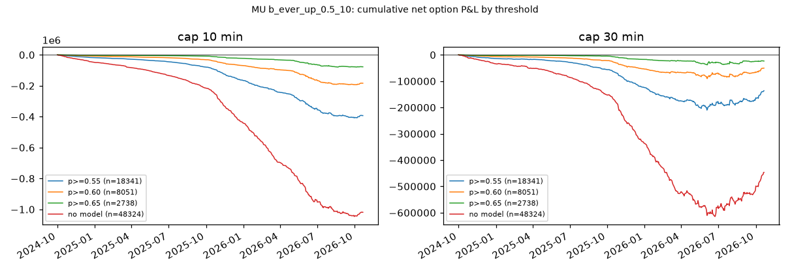
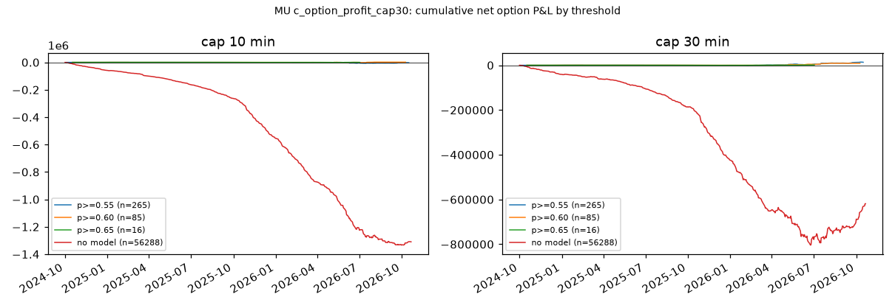

# 方法论 v2 第一轮（MU）

生成：2026-10-22T11:46:13+00:00 UTC · 总耗时 347s · 规格见 docs/METHOD_V2.md，假设预登记见 docs/RESEARCH_LOG.md（R-017～R-027）

## 0. 覆盖矩阵（各月交易日 / 正股 1 分钟日 / 期权日）

| month | trading_days | MU_stock | MU_opt | QQQ_stock | QQQ_opt | SPY_stock | SPY_opt |
|---|---|---|---|---|---|---|---|
| 2023-10 | 22 | 22 | 22 | 22 | 22 | 22 | 22 |
| 2023-11 | 21 | 21 | 21 | 21 | 21 | 21 | 21 |
| 2023-12 | 20 | 20 | 20 | 20 | 20 | 20 | 20 |
| 2024-01 | 21 | 21 | 21 | 21 | 21 | 21 | 21 |
| 2024-02 | 20 | 20 | 20 | 20 | 20 | 20 | 20 |
| 2024-03 | 20 | 20 | 20 | 20 | 20 | 20 | 20 |
| 2024-04 | 22 | 22 | 22 | 22 | 22 | 22 | 22 |
| 2024-05 | 22 | 22 | 22 | 22 | 22 | 22 | 22 |
| 2024-06 | 19 | 19 | 19 | 19 | 19 | 19 | 19 |
| 2024-07 | 22 | 22 | 22 | 22 | 22 | 22 | 21 |
| 2024-08 | 22 | 22 | 22 | 22 | 22 | 22 | 0 |
| 2024-09 | 20 | 20 | 20 | 20 | 20 | 20 | 0 |
| 2024-10 | 23 | 23 | 23 | 23 | 23 | 23 | 0 |
| 2024-11 | 20 | 20 | 20 | 20 | 20 | 20 | 0 |
| 2024-12 | 21 | 21 | 21 | 21 | 21 | 21 | 0 |
| 2025-01 | 20 | 20 | 20 | 20 | 20 | 20 | 0 |
| 2025-02 | 19 | 19 | 19 | 19 | 19 | 19 | 0 |
| 2025-03 | 21 | 21 | 21 | 21 | 21 | 21 | 0 |
| 2025-04 | 21 | 21 | 21 | 21 | 21 | 21 | 0 |
| 2025-05 | 21 | 21 | 21 | 21 | 21 | 21 | 0 |
| 2025-06 | 20 | 20 | 20 | 20 | 20 | 20 | 0 |
| 2025-07 | 22 | 22 | 22 | 22 | 22 | 22 | 0 |
| 2025-08 | 21 | 21 | 21 | 21 | 21 | 21 | 0 |
| 2025-09 | 21 | 21 | 21 | 21 | 21 | 21 | 0 |
| 2025-10 | 23 | 23 | 23 | 23 | 23 | 23 | 0 |
| 2025-11 | 19 | 19 | 19 | 19 | 19 | 19 | 0 |
| 2025-12 | 22 | 22 | 22 | 22 | 22 | 22 | 0 |
| 2026-01 | 20 | 20 | 20 | 20 | 20 | 20 | 0 |
| 2026-02 | 19 | 19 | 19 | 19 | 19 | 19 | 0 |
| 2026-03 | 22 | 22 | 22 | 22 | 22 | 22 | 0 |
| 2026-04 | 21 | 21 | 21 | 21 | 21 | 21 | 0 |
| 2026-05 | 20 | 20 | 20 | 20 | 20 | 20 | 0 |
| 2026-06 | 21 | 21 | 21 | 21 | 21 | 21 | 0 |
| 2026-07 | 22 | 22 | 22 | 22 | 22 | 22 | 0 |
| 2026-08 | 21 | 21 | 21 | 21 | 21 | 21 | 0 |
| 2026-09 | 21 | 21 | 21 | 21 | 21 | 21 | 0 |
| 2026-10 | 15 | 15 | 15 | 15 | 15 | 15 | 0 |

边界：标的 MU；事件样本 2023-10-02～2026-10-21（RTH、交易日历过滤）；期权日 767（2023-10-02～2026-10-21）；事件 121031（含多检测器重复）；费用 D-013 + 买 ask 卖 bid。SPY 期权拉取暂停于 2024-07-30：凡依赖 SPY 期权的部分**未覆盖**；跨资产特征只用 SPY / QQQ / SMH 正股 1 分钟 K（完整）。

## 1. 规则直接回放（规格 2；主结果 = D-022 回踩深度网格，R-029；对照 = 原收紧版 E1，R-017）

### 1.1 主结果：D-022 网格（144 个定义 × 方向 × 持仓上限 = 576 行）

完整表见 `docs/research/E1_PULLBACK_SWEEP_MU.md`（事件表 + 回放全表）。网格 config/e1_sweep.yaml；试验计数与 Bonferroni 门槛见要点表。

要点：

| definitions | event_cells | replay_rows | t_bonf | rows_n_ge_5 | rows_mean_net_gt_0 | rows_t_gt_bonf | rows_pctile_ge_95 | rows_pctile_local_ge_95 | best_mean_net | best_combo | median_mean_net |
|---|---|---|---|---|---|---|---|---|---|---|---|
| 144 | 288 | 576 | 3.92 | 532 | 128 | 0 | 258 | 34 | 236.87 | F\|BB20\|n3\|pctb≤0.50 / long / 30 | -10.64 |

回放边际（持仓上限 10，按维度取中位数）：

| dim | value | rows | median_mean_net | best_mean_net | rows_mean_net>0 | median_real_pctile | median_pctile_local |
|---|---|---|---|---|---|---|---|
| channel | A | 144 | -12.63 | 13.43 | 1 | 99.6 | 44.3 |
| channel | F | 122 | -23.98 | 233.71 | 40 | 37 | 13.2 |
| bb | 10 | 95 | -13.59 | 69.43 | 12 | 95.7 | 6.7 |
| bb | 20 | 90 | -13.05 | 233.71 | 16 | 95.7 | 43.6 |
| bb | 30 | 81 | -13.05 | 98.55 | 13 | 94.9 | 75.5 |
| pattern_n | 2 | 137 | -13.22 | 78.84 | 14 | 96.8 | 9.5 |
| pattern_n | 3 | 129 | -13.15 | 233.71 | 27 | 95.6 | 43.4 |
| kind | eps | 138 | -13.32 | 173.4 | 21 | 94.7 | 27.2 |
| kind | pctb | 128 | -12.87 | 233.71 | 20 | 96.9 | 43.4 |
| side | long | 132 | -10.94 | 233.71 | 38 | 96.4 | 59.8 |
| side | short | 134 | -15 | 63.07 | 3 | 88.7 | 14.2 |
| depth:pctb | 0.3 | 16 | -10.71 | 69.43 | 3 | 92.7 | 81.7 |
| depth:pctb | 0.4 | 18 | -12.84 | 53.31 | 2 | 92.7 | 80.2 |
| depth:pctb | 0.5 | 22 | -14.45 | 233.71 | 3 | 97.3 | 69.8 |
| depth:pctb | 0.6 | 24 | -12.43 | 98.55 | 5 | 96.7 | 71.8 |
| depth:pctb | 0.7 | 24 | -13.13 | 81.14 | 4 | 98 | 16.4 |
| depth:pctb | 0.8 | 24 | -13.46 | 36.24 | 3 | 97.3 | 8.1 |
| depth:eps | 0.0002 | 20 | -12.91 | 173.4 | 4 | 91 | 42.4 |
| depth:eps | 0.0005 | 22 | -13.77 | 84.34 | 4 | 88.5 | 40.3 |
| depth:eps | 0.001 | 24 | -12.91 | 64.84 | 4 | 92.2 | 42.1 |
| depth:eps | 0.002 | 24 | -13.61 | 46.97 | 2 | 96 | 21.5 |
| depth:eps | 0.003 | 24 | -12.54 | 52.67 | 4 | 97 | 16.6 |
| depth:eps | 0.005 | 24 | -13.32 | 40.37 | 3 | 97.6 | 6.4 |

回放边际（持仓上限 30，按维度取中位数）：

| dim | value | rows | median_mean_net | best_mean_net | rows_mean_net>0 | median_real_pctile | median_pctile_local |
|---|---|---|---|---|---|---|---|
| channel | A | 144 | -2.2 | 45.02 | 44 | 99.8 | 26.5 |
| channel | F | 122 | -24.87 | 236.87 | 43 | 21.2 | 8.8 |
| bb | 10 | 95 | -3.33 | 66.57 | 32 | 87.4 | 2.4 |
| bb | 20 | 90 | -2.96 | 236.87 | 29 | 90.2 | 26.4 |
| bb | 30 | 81 | -3.48 | 154.05 | 26 | 92.2 | 53.9 |
| pattern_n | 2 | 137 | -3.33 | 132.11 | 38 | 95.5 | 3.3 |
| pattern_n | 3 | 129 | -2.8 | 236.87 | 49 | 89.4 | 26.7 |
| kind | eps | 138 | -3.97 | 132.11 | 30 | 89 | 12 |
| kind | pctb | 128 | -0.59 | 236.87 | 57 | 93 | 27.9 |
| side | long | 132 | -0.45 | 236.87 | 64 | 90.5 | 41 |
| side | short | 134 | -6.88 | 66.57 | 23 | 89.2 | 7 |
| depth:pctb | 0.3 | 16 | 1.43 | 65.95 | 12 | 94.7 | 67.8 |
| depth:pctb | 0.4 | 18 | -3.68 | 99.87 | 6 | 87.1 | 66.6 |
| depth:pctb | 0.5 | 22 | -1.71 | 236.87 | 10 | 93 | 53.3 |
| depth:pctb | 0.6 | 24 | -0.79 | 154.05 | 9 | 93.5 | 49.2 |
| depth:pctb | 0.7 | 24 | -0.22 | 82.7 | 12 | 94.8 | 7.9 |
| depth:pctb | 0.8 | 24 | -1.03 | 32.31 | 8 | 91.1 | 3.1 |
| depth:eps | 0.0002 | 20 | -5.51 | 122.61 | 5 | 83.7 | 32.1 |
| depth:eps | 0.0005 | 22 | -4.3 | 132.11 | 5 | 83.8 | 28 |
| depth:eps | 0.001 | 24 | -4.77 | 101.89 | 5 | 89.3 | 29.5 |
| depth:eps | 0.002 | 24 | -4.18 | 43.68 | 5 | 90.8 | 7 |
| depth:eps | 0.003 | 24 | -2.76 | 52.94 | 6 | 90.6 | 6 |
| depth:eps | 0.005 | 24 | -3.09 | 40.6 | 4 | 94.2 | 2.8 |

回放前 10 行（n ≥ 30，按 mean_net）：

| combo | channel | bb | pattern_n | kind | value | side | cap | events_opt_days | n | win_rate | payoff | mean_net | sum_net | max_dd | per_day | t_net | rand_p05 | rand_p50 | rand_p95 | real_pctile | local_p50 | real_pctile_local |
|---|---|---|---|---|---|---|---|---|---|---|---|---|---|---|---|---|---|---|---|---|---|---|
| F\|BB20\|n3\|eps≤0.10% | F | 20 | 3 | eps | 0.001 | long | 30 | 30 | 30 | 0.27 | 12.23 | 56.61 | 1698.32 | -283.81 | 1.03 | 1.15 | -1344.8 | -66.4 | 2225 | 89 | 1488.5 | 56.7 |
| F\|BB20\|n3\|eps≤0.10% | F | 20 | 3 | eps | 0.001 | long | 10 | 30 | 30 | 0.27 | 12.46 | 56.6 | 1697.85 | -268.37 | 1.03 | 1.09 | -1418.3 | -339.9 | 1366.8 | 97 | 328.8 | 94.7 |
| F\|BB30\|n3\|eps≤0.30% | F | 30 | 3 | eps | 0.003 | long | 30 | 32 | 32 | 0.31 | 9.64 | 52.94 | 1694.04 | -288.09 | 1.03 | 1.15 | -1331 | -67.2 | 2156.6 | 90.7 | 1578.5 | 55 |
| F\|BB10\|n3\|pctb≤0.40 | F | 10 | 3 | pctb | 0.4 | long | 10 | 33 | 33 | 0.24 | 11.62 | 52.92 | 1746.31 | -415.58 | 1.03 | 1.1 | -1541.1 | -403.7 | 1364.4 | 97.7 | 308 | 94.9 |
| F\|BB30\|n3\|eps≤0.30% | F | 30 | 3 | eps | 0.003 | long | 10 | 32 | 32 | 0.25 | 13.26 | 52.67 | 1685.57 | -280.65 | 1.03 | 1.08 | -1448.6 | -328.4 | 1368.5 | 97.1 | 309.3 | 94.8 |
| F\|BB10\|n3\|pctb≤0.40 | F | 10 | 3 | pctb | 0.4 | long | 30 | 33 | 33 | 0.3 | 8.14 | 49.96 | 1648.79 | -389.04 | 1.03 | 1.11 | -1392.5 | 18 | 2316.3 | 87.4 | 1538.2 | 53 |
| F\|BB20\|n3\|eps≤0.20% | F | 20 | 3 | eps | 0.002 | long | 10 | 37 | 37 | 0.24 | 11.11 | 46.97 | 1737.75 | -424.14 | 1.03 | 1.1 | -1561.9 | -455.2 | 1272.8 | 97.6 | 298.3 | 96.4 |
| A\|BB30\|n2\|pctb≤0.30 | A | 30 | 2 | pctb | 0.3 | long | 30 | 78 | 77 | 0.27 | 6.28 | 45.02 | 3466.17 | -725.72 | 1.07 | 1.43 | -3370.8 | -1381.4 | 1291.3 | 99.6 | 141.3 | 99.8 |
| F\|BB20\|n3\|eps≤0.20% | F | 20 | 3 | eps | 0.002 | long | 30 | 37 | 37 | 0.3 | 7.95 | 43.68 | 1616.23 | -418.74 | 1.03 | 1.09 | -1438.6 | -41.3 | 2152.9 | 89.7 | 1539.9 | 52.3 |
| F\|BB30\|n3\|eps≤0.50% | F | 30 | 3 | eps | 0.005 | long | 30 | 37 | 37 | 0.27 | 8.56 | 40.6 | 1502.27 | -427.88 | 1.03 | 1.01 | -1437.3 | -256.3 | 2085.3 | 89.1 | 1479.1 | 50.7 |

边界：标的 MU；事件样本 2023-10-02～2026-10-21（RTH、交易日历过滤）；期权日 767（2023-10-02～2026-10-21）；事件 121031（含多检测器重复）；费用 D-013 + 买 ask 卖 bid；回踩信号定义见 zr/features/pullback.py（深度 %b / ε 二选一、至少 n 根同日回调后收阳、布林值取信号 bar）；随机对照 = 全天随机分钟（real_pctile）与同日 ±15 分钟时段匹配（real_pctile_local），各 1000 次。

### 1.2 对照行：原收紧版 E1（ε 0.05%、确认 1 根、BB20 × 通道 A/F，16 组）

DTE、时段、星期、D-001、DTE 0–1 时代、通道三步等分层只对这一版做，见 `docs/research/REPLAY_RULE_MU.md`。16 组汇总：
（通道 × 方向 × 持仓上限 × 是否排除 09:30–10:00）

no_contract = 决策分钟没有可买合约（DTE≤5 内都无 ask）的事件数；real_pctile = 真实合计在 1,000 次同日同笔数随机入场中的分位；real_pctile_local = 每笔换成同日 ±15 分钟内随机分钟（时段匹配）后的分位。

| config | events | no_contract | n | win_rate | payoff | mean_net | sum_net | max_dd | per_day | rand_p05 | rand_p50 | rand_p95 | real_pctile | local_p50 | real_pctile_local |
|---|---|---|---|---|---|---|---|---|---|---|---|---|---|---|---|
| A\|long\|cap=10\|all | 8120 | 29 | 8091 | 0.22 | 2.18 | -10.12 | -81863.63 | -93148.09 | 10.83 | -156815.5 | -140520.3 | -123941.9 | 100 | -99443.6 | 98.9 |
| A\|long\|cap=10\|ex0930 | 7905 | 29 | 7876 | 0.22 | 2.24 | -9.68 | -76271.45 | -91193.15 | 10.56 | -146901.5 | -133617.5 | -119556.8 | 100 | -95843 | 99.9 |
| A\|long\|cap=30\|all | 8120 | 29 | 8091 | 0.23 | 2.85 | -3.31 | -26798.91 | -61239.04 | 10.83 | -117956.8 | -99472.6 | -80539.7 | 100 | -41550.9 | 96.9 |
| A\|long\|cap=30\|ex0930 | 7905 | 29 | 7876 | 0.23 | 2.91 | -3.23 | -25402.52 | -62009.96 | 10.56 | -112566.9 | -97501.9 | -80609.6 | 100 | -40749.5 | 98.4 |
| A\|short\|cap=10\|all | 7986 | 7 | 7979 | 0.24 | 1.92 | -10.94 | -87256.04 | -105336.47 | 10.61 | -179641.7 | -163357.5 | -147393.8 | 100 | -108230.5 | 100 |
| A\|short\|cap=10\|ex0930 | 7817 | 7 | 7810 | 0.23 | 1.93 | -10.86 | -84783.63 | -103490.48 | 10.41 | -165793.4 | -151355.9 | -137761.1 | 100 | -105993.9 | 100 |
| A\|short\|cap=30\|all | 7986 | 7 | 7979 | 0.25 | 2.76 | -2.02 | -16157.41 | -70970.59 | 10.61 | -143282.5 | -124324.9 | -105268.3 | 100 | -29052.9 | 96.7 |
| A\|short\|cap=30\|ex0930 | 7817 | 7 | 7810 | 0.25 | 2.78 | -2.16 | -16839.39 | -70199.03 | 10.41 | -132283.7 | -115603.6 | -98128.7 | 100 | -31153.1 | 97 |
| F\|long\|cap=10\|all | 58 | 0 | 58 | 0.31 | 5.15 | 37.31 | 2163.97 | -605.26 | 1.45 | -2630.7 | -768 | 1700.2 | 97.3 | 641.8 | 87 |
| F\|long\|cap=10\|ex0930 | 58 | 0 | 58 | 0.31 | 5.15 | 37.31 | 2163.97 | -605.26 | 1.45 | -2547 | -655.9 | 1757.1 | 97.4 | 641.8 | 87 |
| F\|long\|cap=30\|all | 58 | 0 | 58 | 0.45 | 3.46 | 50.78 | 2945.19 | -605.26 | 1.45 | -2447.2 | 26.1 | 3189.3 | 94 | 2641.7 | 58.6 |
| F\|long\|cap=30\|ex0930 | 58 | 0 | 58 | 0.45 | 3.46 | 50.78 | 2945.19 | -605.26 | 1.45 | -2410.6 | -1 | 3102.2 | 94.1 | 2641.7 | 58.6 |
| F\|short\|cap=10\|all | 76 | 0 | 76 | 0.2 | 1.49 | -19.38 | -1473.18 | -1489.48 | 1.49 | -3263.4 | -1466.2 | 463.6 | 49.5 | -588.8 | 13.6 |
| F\|short\|cap=10\|ex0930 | 76 | 0 | 76 | 0.2 | 1.49 | -19.38 | -1473.18 | -1489.48 | 1.49 | -2768.1 | -1353.2 | 591.4 | 44.8 | -588.8 | 13.6 |
| F\|short\|cap=30\|all | 76 | 0 | 76 | 0.18 | 2.76 | -11.29 | -857.72 | -1040.77 | 1.49 | -2857.6 | -782.6 | 2007.5 | 47.7 | -234.7 | 20 |
| F\|short\|cap=30\|ex0930 | 76 | 0 | 76 | 0.18 | 2.76 | -11.29 | -857.72 | -1040.77 | 1.49 | -2455.1 | -751.7 | 1858.3 | 46.3 | -234.7 | 20 |

边界：标的 MU；事件样本 2023-10-02～2026-10-21（RTH、交易日历过滤）；期权日 767（2023-10-02～2026-10-21）；事件 121031（含多检测器重复）；费用 D-013 + 买 ask 卖 bid；随机对照同 1.1。

## 2. 四条基线（规格 8，R-025）

### 持仓上限 10 分钟（全部期权日）

| baseline | n | win_rate | payoff | mean_net | sum_net | max_dd | per_day | rand_p05 | rand_p95 | ew_pctile_in_random |
|---|---|---|---|---|---|---|---|---|---|---|
| 等权（全部响铃，去重） | 86761 | 0.23 | 1.77 | -18.12 | -1572531.76 | -1593671.11 | 113.12 |  |  |  |
| 随机入场（同日同笔数，1000 次）均值 | 86761 |  |  | -21.56 | -1870967.12 |  |  | -1934666.7 | -1805431.7 | 100 |
| 日历入场（发布后 ≤1 分钟）call | 50 | 0.14 | 1.02 | -99.21 | -4960.45 | -5129.13 | 2 |  |  |  |
| 日历入场（发布后 ≤1 分钟）put | 50 | 0.18 | 2.38 | -48.44 | -2421.83 | -3141.5 | 2 |  |  |  |
| 跨式（等权事件分钟，call+put） | 82501 | 0.15 | 1.57 | -44 | -3630055.21 | -3640483.39 | 107.7 |  |  |  |
| 跨式（日历分钟） | 50 | 0.08 | 1.22 | -147.65 | -7382.28 | -7574.17 | 2 |  |  |  |

### 持仓上限 30 分钟（全部期权日）

| baseline | n | win_rate | payoff | mean_net | sum_net | max_dd | per_day | rand_p05 | rand_p95 | ew_pctile_in_random |
|---|---|---|---|---|---|---|---|---|---|---|
| 等权（全部响铃，去重） | 86761 | 0.25 | 2.31 | -9.45 | -819962.73 | -932944.95 | 113.12 |  |  |  |
| 随机入场（同日同笔数，1000 次）均值 | 86761 |  |  | -15.48 | -1342947.29 |  |  | -1416356.3 | -1266334.9 | 100 |
| 日历入场（发布后 ≤1 分钟）call | 50 | 0.14 | 0.78 | -107.23 | -5361.44 | -5531.12 | 2 |  |  |  |
| 日历入场（发布后 ≤1 分钟）put | 50 | 0.18 | 2.41 | -47.08 | -2353.83 | -3073.5 | 2 |  |  |  |
| 跨式（等权事件分钟，call+put） | 82501 | 0.19 | 1.99 | -31.22 | -2575460.8 | -2635360.75 | 107.7 |  |  |  |
| 跨式（日历分钟） | 50 | 0.08 | 1.17 | -154.31 | -7715.27 | -7907.16 | 2 |  |  |  |

边界：标的 MU；事件样本 2023-10-02～2026-10-21（RTH、交易日历过滤）；期权日 767（2023-10-02～2026-10-21）；事件 121031（含多检测器重复）；费用 D-013 + 买 ask 卖 bid；日历入场只有 RTH 内的发布（FOMC 14:00 与个别 PCE 10:00），CPI / 非农待接入（config/calendar.yaml pending）。

## 3. 标签层概览与预登记分层（规格 5，R-018～R-022）

### 标签随 H 的变化（全部事件）

| H_min | n | mfe_med_bp | mae_med_bp | ever_up_0.3σ | ever_up_0.5σ | ever_up_1.0σ | tb_up | tb_dn | opt_bid_max_med | opt_bid_max_ge20% |
|---|---|---|---|---|---|---|---|---|---|---|
| 1 | 120639 | 4.22 | -4.27 | 0.63 | 0.49 | 0.24 | 0.12 | 0.12 | -0.03 | 0.003 |
| 2 | 120639 | 6.43 | -6.48 | 0.66 | 0.51 | 0.25 | 0.14 | 0.14 | -0.02 | 0.01 |
| 3 | 120639 | 8.16 | -8.15 | 0.68 | 0.53 | 0.26 | 0.15 | 0.15 | -0.02 | 0.02 |
| 5 | 120639 | 10.91 | -10.74 | 0.69 | 0.54 | 0.26 | 0.17 | 0.16 | -0.0074 | 0.04 |
| 10 | 120639 | 15.79 | -15.45 | 0.71 | 0.55 | 0.27 | 0.19 | 0.18 | 0.0065 | 0.08 |
| 15 | 120639 | 19.53 | -18.8 | 0.71 | 0.56 | 0.27 | 0.2 | 0.18 | 0.02 | 0.11 |
| 30 | 120639 | 27.48 | -26.47 | 0.71 | 0.56 | 0.27 | 0.2 | 0.19 | 0.04 | 0.17 |

### R-018 共振：过去 5 分钟同向其他检测器数

| confl_n_same_dir_5m（3=≥3） | n | ever_up_0.5_10 | mfe_10_bp | mae_10_bp | n_opt | mean_net_cap30 |
|---|---|---|---|---|---|---|
| 0.0 | 45034 | 0.55 | 28.35 | -28.38 | 40611 | -13.38 |
| 1.0 | 49651 | 0.55 | 22.87 | -21.7 | 44037 | -5.41 |
| 2.0 | 22581 | 0.57 | 20.22 | -19.26 | 19090 | -4.16 |
| 3.0 | 3765 | 0.57 | 20.87 | -19.7 | 3204 | -5.83 |

### R-018 共振：同向家族数

| confl_families_5m | n | ever_up_0.5_10 | mfe_10_bp | mae_10_bp | n_opt | mean_net_cap30 |
|---|---|---|---|---|---|---|
| 1.0 | 73418 | 0.55 | 25.47 | -25.04 | 65757 | -11.12 |
| 2.0 | 42637 | 0.56 | 22.67 | -21.65 | 36813 | -3.34 |
| 3.0 | 4976 | 0.56 | 22.17 | -20.74 | 4372 | -5.9 |

### R-019 结构：本轮通道第几次回踩

| pullback_idx（3=≥3） | n | ever_up_0.5_10 | mfe_10_bp | mae_10_bp | n_opt | mean_net_cap30 |
|---|---|---|---|---|---|---|
| 0 | 52850 | 0.55 | 29.58 | -29.4 | 47372 | -11.64 |
| 1 | 25205 | 0.55 | 22.91 | -21.94 | 22189 | -7.35 |
| 2 | 15763 | 0.56 | 20.34 | -19.58 | 13792 | -7.55 |
| 3 | 27213 | 0.56 | 17.86 | -16.51 | 23589 | -2.59 |

### R-019 结构：5 分钟 MACD 状态与事件方向

| tf5×方向（1=同向） | n | ever_up_0.5_10 | mfe_10_bp | mae_10_bp | n_opt | mean_net_cap30 |
|---|---|---|---|---|---|---|
| -0.0 | 31731 | 0.55 | 22.62 | -21.71 | 28700 | -9.58 |
| -1.0 | 25191 | 0.55 | 28.06 | -27.72 | 22128 | -9.7 |
| 0.0 | 32451 | 0.55 | 22.02 | -21.41 | 29158 | -6.6 |
| 1.0 | 31658 | 0.57 | 25.53 | -24.73 | 26956 | -7.33 |

### R-019 结构：通道 A 内最大回撤三分位

| channel_max_dd | n | ever_up_0.5_10 | mfe_10_bp | mae_10_bp | n_opt | mean_net_cap30 |
|---|---|---|---|---|---|---|
| 中 | 40343 | 0.56 | 27.66 | -27.09 | 35464 | -11.31 |
| 低 | 40344 | 0.55 | 21.85 | -21.64 | 35706 | -5.78 |
| 高 | 40344 | 0.55 | 23.54 | -22.28 | 35772 | -7.6 |

### R-020 日历：距下一个定时发布 ≤ 30 分钟

| ≤30 分钟 | n | ever_up_0.5_10 | mfe_10_bp | mae_10_bp | n_opt | mean_net_cap30 |
|---|---|---|---|---|---|---|
| False | 120683 | 0.55 | 24.36 | -23.66 | 106594 | -8.17 |
| True | 348 | 0.59 | 22.34 | -28.23 | 348 | -25.6 |

### R-020 日历：是否到期日

| is_expiry_day（NaN=无期权数据） | n | ever_up_0.5_10 | mfe_10_bp | mae_10_bp | n_opt | mean_net_cap30 |
|---|---|---|---|---|---|---|
| 0.0 | 91035 | 0.56 | 24.18 | -23.46 | 80666 | -11.37 |
| 1.0 | 29996 | 0.55 | 24.88 | -24.3 | 26276 | 1.44 |

### R-021 跨资产：SPY/QQQ/SMH 同分钟同向个数

| xa_n_same_sign | n | ever_up_0.5_10 | mfe_10_bp | mae_10_bp | n_opt | mean_net_cap30 |
|---|---|---|---|---|---|---|
| 0.0 | 17651 | 0.55 | 20.89 | -20.14 | 15496 | -9.03 |
| 1.0 | 14363 | 0.55 | 22.3 | -22.07 | 12629 | -10.49 |
| 2.0 | 17279 | 0.55 | 23.28 | -23.02 | 15279 | -7.9 |
| 3.0 | 71396 | 0.56 | 25.59 | -24.75 | 63196 | -6.93 |

边界：标的 MU；事件样本 2023-10-02～2026-10-21（RTH、交易日历过滤）；期权日 767（2023-10-02～2026-10-21）；事件 121031（含多检测器重复）；费用 D-013 + 买 ask 卖 bid；ever_up / MFE 用正股 1 分钟高低点（日内）；net_cap30 只在期权日有值；分层为描述性，未做多重比较修正。

## 4. 模型（规格 6，R-023）

GBDT 参数固定（叶子 31、300 轮、学习率 0.03，不调参），唯一性加权，训练 12 月 / 测试 1 月 / embargo 1 天滚动，**无验证集**。

### 目标 b_ever_up_0.5_10（后端 sklearn_hgb，特征 98 个，正例率 0.554）

事件 107118，样本外 68463（25 个测试月），**样本外 AUC 0.5428**；逐月 AUC 均值 0.5420，>0.5 的月份 100%。

十分位（样本外）：

| decile | n | per_day | p_mean | y_rate | mean_net_cap30 | mean_net_cap10 |
|---|---|---|---|---|---|---|
| 1 | 6847 | 13.27 | 0.39 | 0.49 | -11.44 | -22.06 |
| 2 | 6846 | 13.27 | 0.45 | 0.54 | -4.54 | -15.81 |
| 3 | 6846 | 13.27 | 0.48 | 0.54 | -9.24 | -20.39 |
| 4 | 6846 | 13.27 | 0.51 | 0.54 | -9.92 | -21.11 |
| 5 | 6847 | 13.27 | 0.53 | 0.57 | -8.75 | -17.7 |
| 6 | 6846 | 13.27 | 0.54 | 0.56 | -8.65 | -19.63 |
| 7 | 6846 | 13.27 | 0.56 | 0.57 | -5.75 | -17.74 |
| 8 | 6846 | 13.27 | 0.59 | 0.58 | -6.61 | -19.17 |
| 9 | 6846 | 13.27 | 0.62 | 0.61 | -3.05 | -16.72 |
| 10 | 6847 | 13.27 | 0.68 | 0.63 | -9.49 | -27.38 |

校准：

| bin | n | p_mean | y_rate |
|---|---|---|---|
| (0.1, 0.2] | 45 | 0.18 | 0.36 |
| (0.2, 0.3] | 380 | 0.27 | 0.37 |
| (0.3, 0.4] | 2980 | 0.37 | 0.48 |
| (0.4, 0.5] | 18897 | 0.46 | 0.53 |
| (0.5, 0.6] | 32038 | 0.55 | 0.56 |
| (0.6, 0.7] | 12519 | 0.64 | 0.61 |
| (0.7, 0.8] | 1556 | 0.73 | 0.67 |
| (0.8, 0.9] | 48 | 0.82 | 0.65 |

逐月 AUC：

| month | n_train | n_test | auc |
|---|---|---|---|
| 2024-10 | 38533 | 3639 | 0.54 |
| 2024-11 | 38936 | 2653 | 0.54 |
| 2024-12 | 37994 | 2788 | 0.58 |
| 2025-01 | 36732 | 2662 | 0.51 |
| 2025-02 | 35588 | 2653 | 0.52 |
| 2025-03 | 34868 | 2489 | 0.53 |
| 2025-04 | 34285 | 2342 | 0.54 |
| 2025-05 | 33727 | 3152 | 0.54 |
| 2025-06 | 33512 | 3070 | 0.56 |
| 2025-07 | 33754 | 3439 | 0.56 |
| 2025-08 | 34365 | 3372 | 0.55 |
| 2025-09 | 35117 | 3035 | 0.53 |
| 2025-10 | 35153 | 2851 | 0.55 |
| 2025-11 | 34431 | 1980 | 0.52 |
| 2025-12 | 33833 | 2854 | 0.53 |
| 2026-01 | 33693 | 2281 | 0.55 |
| 2026-02 | 33518 | 2036 | 0.53 |
| 2026-03 | 32901 | 2634 | 0.53 |
| 2026-04 | 32938 | 2320 | 0.58 |
| 2026-05 | 32907 | 2155 | 0.54 |
| 2026-06 | 32027 | 2382 | 0.54 |
| 2026-07 | 31197 | 2603 | 0.54 |
| 2026-08 | 30406 | 3029 | 0.55 |
| 2026-09 | 29973 | 3799 | 0.56 |
| 2026-10 | 30639 | 2245 | 0.55 |

### 目标 c_option_profit_cap30（后端 sklearn_hgb，特征 97 个，正例率 0.246）

事件 106942，样本外 68487（25 个测试月），**样本外 AUC 0.6020**；逐月 AUC 均值 0.5880，>0.5 的月份 96%。

十分位（样本外）：

| decile | n | per_day | p_mean | y_rate | mean_net_cap30 | mean_net_cap10 |
|---|---|---|---|---|---|---|
| 1 | 6849 | 13.27 | 0.1 | 0.13 | -45.8 | -47.5 |
| 2 | 6849 | 13.27 | 0.15 | 0.19 | -24.32 | -28.18 |
| 3 | 6848 | 13.27 | 0.18 | 0.22 | -16.71 | -22.34 |
| 4 | 6849 | 13.27 | 0.2 | 0.24 | -14.5 | -21.25 |
| 5 | 6849 | 13.27 | 0.23 | 0.25 | -11.91 | -21.26 |
| 6 | 6848 | 13.27 | 0.26 | 0.28 | -6.49 | -18.87 |
| 7 | 6849 | 13.27 | 0.29 | 0.3 | -2.5 | -17.63 |
| 8 | 6848 | 13.27 | 0.32 | 0.32 | 1.01 | -15.55 |
| 9 | 6849 | 13.27 | 0.37 | 0.33 | 9.22 | -13.21 |
| 10 | 6849 | 13.27 | 0.45 | 0.38 | 20.06 | -9.04 |

校准：

| bin | n | p_mean | y_rate |
|---|---|---|---|
| (-0.001, 0.1] | 2861 | 0.08 | 0.1 |
| (0.1, 0.2] | 19662 | 0.16 | 0.2 |
| (0.2, 0.3] | 24518 | 0.25 | 0.27 |
| (0.3, 0.4] | 14728 | 0.34 | 0.33 |
| (0.4, 0.5] | 5642 | 0.44 | 0.37 |
| (0.5, 0.6] | 972 | 0.53 | 0.4 |
| (0.6, 0.7] | 102 | 0.63 | 0.53 |
| (0.7, 0.8] | 2 | 0.7 | 0 |

逐月 AUC：

| month | n_train | n_test | auc |
|---|---|---|---|
| 2024-10 | 38323 | 3580 | 0.59 |
| 2024-11 | 38713 | 2623 | 0.63 |
| 2024-12 | 37848 | 2774 | 0.6 |
| 2025-01 | 36605 | 2642 | 0.65 |
| 2025-02 | 35495 | 2706 | 0.49 |
| 2025-03 | 34842 | 2543 | 0.59 |
| 2025-04 | 34311 | 2328 | 0.56 |
| 2025-05 | 33713 | 3173 | 0.58 |
| 2025-06 | 33531 | 2979 | 0.59 |
| 2025-07 | 33683 | 3431 | 0.54 |
| 2025-08 | 34230 | 3298 | 0.66 |
| 2025-09 | 34895 | 3005 | 0.62 |
| 2025-10 | 34935 | 2877 | 0.65 |
| 2025-11 | 34297 | 2029 | 0.61 |
| 2025-12 | 33785 | 2995 | 0.6 |
| 2026-01 | 33792 | 2367 | 0.63 |
| 2026-02 | 33731 | 2122 | 0.61 |
| 2026-03 | 33147 | 2647 | 0.61 |
| 2026-04 | 33131 | 2337 | 0.6 |
| 2026-05 | 33154 | 2235 | 0.59 |
| 2026-06 | 32322 | 2363 | 0.56 |
| 2026-07 | 31551 | 2582 | 0.59 |
| 2026-08 | 30768 | 2960 | 0.53 |
| 2026-09 | 30331 | 3714 | 0.51 |
| 2026-10 | 30934 | 2177 | 0.51 |

边界：标的 MU；事件样本 2023-10-02～2026-10-21（RTH、交易日历过滤）；期权日 767（2023-10-02～2026-10-21）；事件 121031（含多检测器重复）；费用 D-013 + 买 ask 卖 bid；样本外月份见逐月表。

## 5. 决策模拟（规格 7，R-024）

### 目标 b_ever_up_0.5_10（样本外 25 个月：2024-10～2026-10）

| group | cap | n | win_rate | payoff | mean_net | sum_net | max_dd | per_day | delta_mean_vs_no_model |
|---|---|---|---|---|---|---|---|---|---|
| 无模型（全部事件去重） | 10 | 48324 | 0.24 | 1.73 | -21.09 | -1018981.89 | -1050040.96 | 93.65 |  |
| E1T 回放（同月份） | 10 | 9254 | 0.25 | 2.01 | -12.12 | -112136.32 | -132260.15 | 18 |  |
| 模型 p ≥ 0.55 | 10 | 18341 | 0.24 | 1.73 | -21.42 | -392938.68 | -411024.03 | 35.54 | -0.34 |
| 模型 p ≥ 0.60 | 10 | 8051 | 0.26 | 1.68 | -22.79 | -183463.8 | -195278.82 | 15.69 | -1.7 |
| 模型 p ≥ 0.65 | 10 | 2738 | 0.27 | 1.53 | -28.22 | -77263.89 | -80559.96 | 5.98 | -7.13 |
| 无模型（全部事件去重） | 30 | 48324 | 0.26 | 2.32 | -9.25 | -446782.98 | -620967 | 93.65 |  |
| E1T 回放（同月份） | 30 | 9254 | 0.26 | 2.78 | -0.37 | -3395.44 | -88959.49 | 18 |  |
| 模型 p ≥ 0.55 | 30 | 18341 | 0.27 | 2.35 | -7.45 | -136567.9 | -210953.96 | 35.54 | 1.8 |
| 模型 p ≥ 0.60 | 30 | 8051 | 0.28 | 2.28 | -6.26 | -50393.31 | -90262.55 | 15.69 | 2.99 |
| 模型 p ≥ 0.65 | 30 | 2738 | 0.3 | 1.99 | -8.53 | -23366.87 | -38080.65 | 5.98 | 0.71 |




同一批月份的四条基线（持仓上限 30）：

| baseline | n | win_rate | payoff | mean_net | sum_net | max_dd | per_day | rand_p05 | rand_p95 | ew_pctile_in_random |
|---|---|---|---|---|---|---|---|---|---|---|
| 等权（全部响铃，去重） | 56288 | 0.26 | 2.23 | -11 | -618941.9 | -732765.12 | 109.09 |  |  |  |
| 随机入场（同日同笔数，1000 次）均值 | 56288 |  |  | -19.47 | -1095808.33 |  |  | -1170197.5 | -1020676.4 | 100 |
| 日历入场（发布后 ≤1 分钟）call | 34 | 0.12 | 1.07 | -124.99 | -4249.56 | -4395.74 | 2 |  |  |  |
| 日历入场（发布后 ≤1 分钟）put | 34 | 0.27 | 2.2 | -20.63 | -701.57 | -1390.32 | 2 |  |  |  |
| 跨式（等权事件分钟，call+put） | 53374 | 0.21 | 1.87 | -39.43 | -2104270.61 | -2164689.34 | 103.64 |  |  |  |
| 跨式（日历分钟） | 34 | 0.09 | 1.54 | -145.62 | -4951.13 | -4991.02 | 2 |  |  |  |

### 目标 c_option_profit_cap30（样本外 25 个月：2024-10～2026-10）

| group | cap | n | win_rate | payoff | mean_net | sum_net | max_dd | per_day | delta_mean_vs_no_model |
|---|---|---|---|---|---|---|---|---|---|
| 无模型（全部事件去重） | 10 | 56288 | 0.25 | 1.71 | -23.27 | -1309776.25 | -1339073.01 | 109.09 |  |
| E1T 回放（同月份） | 10 | 9813 | 0.26 | 1.96 | -12.52 | -122891.58 | -140083.54 | 19.02 |  |
| 模型 p ≥ 0.55 | 10 | 265 | 0.39 | 1.46 | -11.33 | -3002.18 | -7482.86 | 2.57 | 11.94 |
| 模型 p ≥ 0.60 | 10 | 85 | 0.43 | 1.47 | 17.03 | 1447.41 | -3856.74 | 2.36 | 40.3 |
| 模型 p ≥ 0.65 | 10 | 16 | 0.5 | 0.99 | -0.82 | -13.19 | -648.14 | 1.45 | 22.44 |
| 无模型（全部事件去重） | 30 | 56288 | 0.26 | 2.23 | -11 | -618941.9 | -816183.3 | 109.09 |  |
| E1T 回放（同月份） | 30 | 9813 | 0.27 | 2.68 | -0.76 | -7421.85 | -91312.54 | 19.02 |  |
| 模型 p ≥ 0.55 | 30 | 265 | 0.43 | 1.81 | 50.7 | 13434.53 | -4650.61 | 2.57 | 61.69 |
| 模型 p ≥ 0.60 | 30 | 85 | 0.51 | 1.88 | 101.53 | 8629.93 | -2937.72 | 2.36 | 112.52 |
| 模型 p ≥ 0.65 | 30 | 16 | 0.44 | 2.89 | 71.83 | 1149.22 | -360.31 | 1.45 | 82.82 |

注：模型 p ≥ 0.65 有配置笔数 < 30，样本过少，不作结论；固定阈值高于该目标的正例率时几乎不触发，参考第 4 节十分位表。



同一批月份的四条基线（持仓上限 30）：

| baseline | n | win_rate | payoff | mean_net | sum_net | max_dd | per_day | rand_p05 | rand_p95 | ew_pctile_in_random |
|---|---|---|---|---|---|---|---|---|---|---|
| 等权（全部响铃，去重） | 56288 | 0.26 | 2.23 | -11 | -618941.9 | -732765.12 | 109.09 |  |  |  |
| 随机入场（同日同笔数，1000 次）均值 | 56288 |  |  | -19.47 | -1095808.33 |  |  | -1170197.5 | -1020676.4 | 100 |
| 日历入场（发布后 ≤1 分钟）call | 34 | 0.12 | 1.07 | -124.99 | -4249.56 | -4395.74 | 2 |  |  |  |
| 日历入场（发布后 ≤1 分钟）put | 34 | 0.27 | 2.2 | -20.63 | -701.57 | -1390.32 | 2 |  |  |  |
| 跨式（等权事件分钟，call+put） | 53374 | 0.21 | 1.87 | -39.43 | -2104270.61 | -2164689.34 | 103.64 |  |  |  |
| 跨式（日历分钟） | 34 | 0.09 | 1.54 | -145.62 | -4951.13 | -4991.02 | 2 |  |  |  |

「模型过滤有没有附加价值」= 阈值组的 mean_net 与无模型组之差（delta_mean_vs_no_model 列）；附加价值为正但绝对值仍为负时，模型只是少亏，不构成可交易的边。

边界：标的 MU；事件样本 2023-10-02～2026-10-21（RTH、交易日历过滤）；期权日 767（2023-10-02～2026-10-21）；事件 121031（含多检测器重复）；费用 D-013 + 买 ask 卖 bid；只在样本外月份。

## 6. 审计（规格 10，R-026）

### 植入信号（随机 5% 事件 MFE_10 +20 bp，附指示特征；最近 8 个测试月）

| n_oos | planted_share | auc_all | auc_planted_vs_rest | mean_p_planted | mean_p_rest | y_rate_planted | y_rate_rest |
|---|---|---|---|---|---|---|---|
| 21167 | 0.05 | 0.58 | 0.99 | 0.93 | 0.55 | 0.94 | 0.58 |

### 标签打乱（月内打乱 ever_up_0.5_10；最近 8 个测试月）

| n_oos | auc | fold_auc_min | fold_auc_max |
|---|---|---|---|
| 21167 | 0.51 | 0.48 | 0.52 |

### 前视检查清单（实际运行 pytest）

| 组 | 测试 | 结果 | 通过 |
|---|---|---|---|
| 正股特征 23 列 | tests/test_features.py | 27 passed in 0.56s | True |
| 通道 A/B/C/D/F 与质量 | tests/test_channel.py | 3 passed in 0.22s | True |
| 结构上下文 / tf5 / 日历 / 跨资产 / 共振 | tests/test_features_v2.py | 6 passed in 0.27s | True |
| 期权特征（对齐 t+1 报价） | tests/test_option_features.py | 11 passed in 4.49s | True |
| 指标（ATR / KDJ / ADX 等） | tests/test_indicators.py | 13 passed in 0.16s | True |
| 标签 v2（窗口 t+1..t+H、同日） | tests/test_labels_v2.py | 3 passed, 4 warnings in 0.16s | True |
| 期权结果表（决策分钟 ask、bid 出场） | tests/test_outcomes.py | 5 passed in 0.58s | True |
| 交易日历 / RTH | tests/test_session.py | 7 passed in 0.19s | True |

### 手工复算 10 个事件（独立读原始 parquet）

| ts_et | detector | direction | symbol | mfe_10_dataset | mfe_10_manual | net_cap30_dataset | net_cap30_manual | mfe_match | pnl_match |
|---|---|---|---|---|---|---|---|---|---|
| 2024-10-22 12:51 | E1 | 1 | MU241025C108000.US | 0.004388 | 0.004388 | 30.86 | 30.86 | True | True |
| 2025-05-14 09:50 | E9 | 1 | MU250516C100000.US | 0.00323 | 0.00323 | 4.86 | 4.86 | True | True |
| 2024-05-02 14:55 | E5 | -1 | MU240503P112000.US | 0.000714 | 0.000714 | -15.14 | -15.14 | True | True |
| 2025-07-15 14:46 | E1 | -1 | MU250718P120000.US | 0.002412 | 0.002412 | 10.86 | 10.86 | True | True |
| 2023-11-06 12:47 | E3 | 1 | MU231110C73000.US | 0.000621 | 0.000621 | -11.14 | -11.14 | True | True |
| 2024-10-18 12:46 | E1 | -1 | MU241018P110000.US | 0.000727 | 0.000727 | -13.14 | -13.14 | True | True |
| 2024-12-13 11:38 | E1 | 1 | MU241213C101000.US | 9.9e-05 | 9.9e-05 | -25.14 | -25.14 | True | True |
| 2025-04-28 13:49 | E1 | 1 | MU250502C78000.US | 0.002975 | 0.002975 | 0.86 | 0.86 | True | True |
| 2026-06-09 10:09 | E2 | -1 | MU260612P965000.US | 0.02 | 0.02 | 1044.69 | 1044.69 | True | True |
| 2023-12-15 14:44 | E1 | 1 | MU231215C82000.US | 0.001168 | 0.001168 | -5.14 | -5.14 | True | True |

### 1 / 2 / 5 分钟分周期（E1T：通道 A 回踩，10 分钟方向化收益）

| timeframe | events | per_day | fwd_10min_mean_bp | hit_rate | n_with_fwd |
|---|---|---|---|---|---|
| 1min | 18279 | 23.83 | 1.26 | 0.51 | 17687 |
| 2min | 6310 | 8.23 | 0.71 | 0.49 | 6054 |
| 5min | 1412 | 1.84 | -0.45 | 0.47 | 1341 |

边界：标的 MU；事件样本 2023-10-02～2026-10-21（RTH、交易日历过滤）；期权日 767（2023-10-02～2026-10-21）；事件 121031（含多检测器重复）；费用 D-013 + 买 ask 卖 bid。

## 7. 秒级（规格 10，R-027）

录制器数据：{'days': ['2026-10-21'], '2026-10-21_stock_pushes': 13404, '2026-10-21_option_contracts': 76, '2026-10-21_span_min': np.float64(78.0)}。**只有 1 个不完整交易日（约 78 分钟），只验证流水线，不下结论。**

| day | N_s | x_pct | events | with_option | same_dir_10s | mean_bid_chg_10s | tradable_10s | same_dir_30s | mean_bid_chg_30s | tradable_30s | same_dir_60s | mean_bid_chg_60s | tradable_60s | same_dir_120s | mean_bid_chg_120s | tradable_120s |
|---|---|---|---|---|---|---|---|---|---|---|---|---|---|---|---|---|
| 2026-10-21 | 5 | 0.05 | 239 | 232 | 0.59 | 0.03 | 0.99 | 0.5 | 0.03 | 0.98 | 0.46 | 0.02 | 0.96 | 0.47 | 0.03 | 0.99 |
| 2026-10-21 | 5 | 0.1 | 33 | 32 | 0.66 | 0.06 | 1 | 0.56 | 0.07 | 1 | 0.59 | 0.07 | 1 | 0.59 | 0.08 | 1 |
| 2026-10-21 | 5 | 0.2 | 1 | 1 | 0 | 0 | 1 | 0 | 0 | 1 | 0 | 0 | 1 | 0 | 0 | 1 |
| 2026-10-21 | 10 | 0.05 | 226 | 219 | 0.53 | 0.02 | 0.98 | 0.47 | 0.01 | 0.96 | 0.45 | 0.02 | 0.98 | 0.41 | 0.01 | 0.99 |
| 2026-10-21 | 10 | 0.1 | 56 | 55 | 0.58 | 0.03 | 1 | 0.46 | 0.03 | 1 | 0.38 | 0.02 | 0.98 | 0.51 | 0.03 | 1 |
| 2026-10-21 | 10 | 0.2 | 2 | 2 | 0 | -0.02 | 1 | 0.5 | 0.06 | 1 | 0.5 | 0.1 | 1 | 0.5 | 0.09 | 1 |
| 2026-10-21 | 30 | 0.05 | 132 | 130 | 0.45 | 0.0076 | 0.96 | 0.51 | 0.0071 | 0.98 | 0.48 | 0.01 | 0.97 | 0.55 | 0.02 | 0.99 |
| 2026-10-21 | 30 | 0.1 | 76 | 76 | 0.49 | 0.02 | 1 | 0.46 | 0.02 | 0.97 | 0.45 | 0.02 | 0.99 | 0.45 | 0.01 | 0.97 |
| 2026-10-21 | 30 | 0.2 | 12 | 12 | 0.42 | -0.0061 | 1 | 0.5 | 0.0032 | 1 | 0.5 | 0.02 | 1 | 0.42 | 0.01 | 0.92 |

数据集事件在录制日的 10 / 30 秒标签：样本 28；ret_10s 均值 0.82 bp、ret_30s 均值 1.41 bp。

边界：MU 2026-10-21 14:46–16:05 ET；长桥 Depth 一档、非 NBBO；时间为本地接收时间。

## 复现

```bash
uv run python -m zr.research.outcomes --symbol MU.US
uv run python -m zr.research.dataset_v2 --symbol MU.US
uv run python -m zr.research.method_v2_round1 --symbol MU.US
```

## 补充（2026-10-25）

`zr/research/run.py` 的期权盈亏是近似模型：权利金按「正股价格 × 比例 × delta」估算，不来自真实期权报价；费用部分为 D-013。该近似仅用于 W2 的方法演示，其结论已被后续 V4 / R-049 的真实报价检验取代，不应单独引用。
