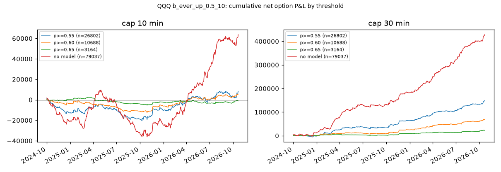
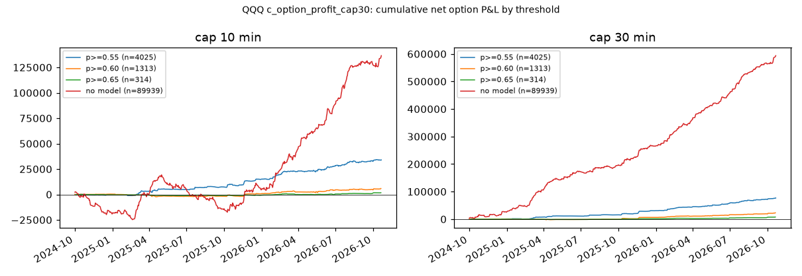

# 方法论 v2 第一轮（QQQ）

> **警告（2026-10-22）**：QQQ 期权结果表在 2025–2026 年多空两个方向的随机分钟扣费后均值都为正，疑似数据或规则伪影（见 docs/STATUS.md 待确认 0）。本报告中依赖期权盈亏的结论（回放、基线、决策模拟、分层 net 列）暂不可用；正股标签、模型 AUC、审计不受影响。SPY 期权未覆盖。

生成：2026-10-22T11:53:46+00:00 UTC · 总耗时 453s · 规格见 docs/METHOD_V2.md，假设预登记见 docs/RESEARCH_LOG.md（R-017～R-027）

## 0. 覆盖矩阵（各月交易日 / 正股 1 分钟日 / 期权日）

| month | trading_days | MU_stock | MU_opt | QQQ_stock | QQQ_opt | SPY_stock | SPY_opt |
|---|---|---|---|---|---|---|---|
| 2023-10 | 22 | 22 | 22 | 22 | 22 | 22 | 22 |
| 2023-11 | 21 | 21 | 21 | 21 | 21 | 21 | 21 |
| 2023-12 | 20 | 20 | 20 | 20 | 20 | 20 | 20 |
| 2024-01 | 21 | 21 | 21 | 21 | 21 | 21 | 21 |
| 2024-02 | 20 | 20 | 20 | 20 | 20 | 20 | 20 |
| 2024-03 | 20 | 20 | 20 | 20 | 20 | 20 | 20 |
| 2024-04 | 22 | 22 | 22 | 22 | 22 | 22 | 22 |
| 2024-05 | 22 | 22 | 22 | 22 | 22 | 22 | 22 |
| 2024-06 | 19 | 19 | 19 | 19 | 19 | 19 | 19 |
| 2024-07 | 22 | 22 | 22 | 22 | 22 | 22 | 21 |
| 2024-08 | 22 | 22 | 22 | 22 | 22 | 22 | 0 |
| 2024-09 | 20 | 20 | 20 | 20 | 20 | 20 | 0 |
| 2024-10 | 23 | 23 | 23 | 23 | 23 | 23 | 0 |
| 2024-11 | 20 | 20 | 20 | 20 | 20 | 20 | 0 |
| 2024-12 | 21 | 21 | 21 | 21 | 21 | 21 | 0 |
| 2025-01 | 20 | 20 | 20 | 20 | 20 | 20 | 0 |
| 2025-02 | 19 | 19 | 19 | 19 | 19 | 19 | 0 |
| 2025-03 | 21 | 21 | 21 | 21 | 21 | 21 | 0 |
| 2025-04 | 21 | 21 | 21 | 21 | 21 | 21 | 0 |
| 2025-05 | 21 | 21 | 21 | 21 | 21 | 21 | 0 |
| 2025-06 | 20 | 20 | 20 | 20 | 20 | 20 | 0 |
| 2025-07 | 22 | 22 | 22 | 22 | 22 | 22 | 0 |
| 2025-08 | 21 | 21 | 21 | 21 | 21 | 21 | 0 |
| 2025-09 | 21 | 21 | 21 | 21 | 21 | 21 | 0 |
| 2025-10 | 23 | 23 | 23 | 23 | 23 | 23 | 0 |
| 2025-11 | 19 | 19 | 19 | 19 | 19 | 19 | 0 |
| 2025-12 | 22 | 22 | 22 | 22 | 22 | 22 | 0 |
| 2026-01 | 20 | 20 | 20 | 20 | 20 | 20 | 0 |
| 2026-02 | 19 | 19 | 19 | 19 | 19 | 19 | 0 |
| 2026-03 | 22 | 22 | 22 | 22 | 22 | 22 | 0 |
| 2026-04 | 21 | 21 | 21 | 21 | 21 | 21 | 0 |
| 2026-05 | 20 | 20 | 20 | 20 | 20 | 20 | 0 |
| 2026-06 | 21 | 21 | 21 | 21 | 21 | 21 | 0 |
| 2026-07 | 22 | 22 | 22 | 22 | 22 | 22 | 0 |
| 2026-08 | 21 | 21 | 21 | 21 | 21 | 21 | 0 |
| 2026-09 | 21 | 21 | 21 | 21 | 21 | 21 | 0 |
| 2026-10 | 15 | 15 | 15 | 15 | 15 | 15 | 0 |

边界：标的 QQQ；事件样本 2023-10-02～2026-10-21（RTH、交易日历过滤）；期权日 767（2023-10-02～2026-10-21）；事件 223485（含多检测器重复）；费用 D-013 + 买 ask 卖 bid。SPY 期权拉取暂停于 2024-07-30：凡依赖 SPY 期权的部分**未覆盖**；跨资产特征只用 SPY / QQQ / SMH 正股 1 分钟 K（完整）。

## 1. 规则直接回放（规格 2；主结果 = D-022 回踩深度网格，R-029；对照 = 原收紧版 E1，R-017）

### 1.1 主结果：D-022 网格（144 个定义 × 方向 × 持仓上限 = 576 行）

完整表见 `docs/research/E1_PULLBACK_SWEEP_QQQ.md`（事件表 + 回放全表）。网格 config/e1_sweep.yaml；试验计数与 Bonferroni 门槛见要点表。

要点：

| definitions | event_cells | replay_rows | t_bonf | rows_n_ge_5 | rows_mean_net_gt_0 | rows_t_gt_bonf | rows_pctile_ge_95 | rows_pctile_local_ge_95 | best_mean_net | best_combo | median_mean_net |
|---|---|---|---|---|---|---|---|---|---|---|---|
| 144 | 288 | 576 | 3.92 | 512 | 484 | 129 | 259 | 28 | 31.46 | F\|BB20\|n2\|eps≤0.02% / short / 30 | 4.99 |

回放边际（持仓上限 10，按维度取中位数）：

| dim | value | rows | median_mean_net | best_mean_net | rows_mean_net>0 | median_real_pctile | median_pctile_local |
|---|---|---|---|---|---|---|---|
| channel | A | 144 | 3.52 | 9.76 | 139 | 100 | 1.3 |
| channel | F | 112 | 4.58 | 22.14 | 100 | 51.1 | 14.7 |
| bb | 10 | 95 | 4.15 | 10.56 | 86 | 85.1 | 0.9 |
| bb | 20 | 86 | 3.98 | 22.14 | 82 | 95.6 | 13.7 |
| bb | 30 | 75 | 3.4 | 18.88 | 71 | 98.6 | 20.2 |
| pattern_n | 2 | 131 | 3.46 | 22.14 | 119 | 98.3 | 0.6 |
| pattern_n | 3 | 125 | 4.16 | 19.13 | 120 | 94.8 | 17.5 |
| kind | eps | 137 | 3.57 | 20.08 | 124 | 94.8 | 0.9 |
| kind | pctb | 119 | 4.16 | 22.14 | 115 | 98.4 | 17.5 |
| side | long | 128 | 2.91 | 19.13 | 115 | 96.6 | 8.7 |
| side | short | 128 | 4.16 | 22.14 | 124 | 94.5 | 7.9 |
| depth:pctb | 0.3 | 16 | 4.03 | 9.76 | 13 | 84.9 | 41 |
| depth:pctb | 0.4 | 16 | 3.18 | 10.56 | 16 | 93.6 | 51.1 |
| depth:pctb | 0.5 | 18 | 4.29 | 22.14 | 17 | 99.9 | 35.9 |
| depth:pctb | 0.6 | 21 | 4.07 | 19.13 | 21 | 99 | 26.1 |
| depth:pctb | 0.7 | 24 | 4.28 | 18.88 | 24 | 95.5 | 12.7 |
| depth:pctb | 0.8 | 24 | 4.16 | 8.4 | 24 | 89.6 | 0.6 |
| depth:eps | 0.0002 | 19 | 1.98 | 20.08 | 15 | 94.8 | 27.8 |
| depth:eps | 0.0005 | 22 | 2.16 | 11.34 | 17 | 93.8 | 9.4 |
| depth:eps | 0.001 | 24 | 2.54 | 10.6 | 21 | 88 | 0.8 |
| depth:eps | 0.002 | 24 | 3.84 | 9.83 | 23 | 93.1 | 0.4 |
| depth:eps | 0.003 | 24 | 4.16 | 8.4 | 24 | 89.4 | 0.3 |
| depth:eps | 0.005 | 24 | 4.22 | 8.4 | 24 | 89.6 | 0.4 |

回放边际（持仓上限 30，按维度取中位数）：

| dim | value | rows | median_mean_net | best_mean_net | rows_mean_net>0 | median_real_pctile | median_pctile_local |
|---|---|---|---|---|---|---|---|
| channel | A | 144 | 7.44 | 15.8 | 144 | 100 | 0.3 |
| channel | F | 112 | 6.41 | 31.46 | 101 | 40.8 | 13.8 |
| bb | 10 | 95 | 7.83 | 24.74 | 89 | 83 | 0.2 |
| bb | 20 | 86 | 7.54 | 31.46 | 84 | 94.6 | 6.8 |
| bb | 30 | 75 | 6.52 | 28.8 | 72 | 98.9 | 15.1 |
| pattern_n | 2 | 131 | 6.77 | 31.46 | 123 | 99.1 | 0 |
| pattern_n | 3 | 125 | 7.82 | 28.8 | 122 | 93.6 | 15.1 |
| kind | eps | 137 | 6.8 | 31.46 | 128 | 96.5 | 0.1 |
| kind | pctb | 119 | 7.82 | 28.8 | 117 | 96.4 | 15 |
| side | long | 128 | 6.29 | 28.8 | 118 | 97 | 2.1 |
| side | short | 128 | 9.02 | 31.46 | 127 | 93.3 | 3 |
| depth:pctb | 0.3 | 16 | 6.75 | 17.09 | 15 | 78.2 | 45.5 |
| depth:pctb | 0.4 | 16 | 6.14 | 15.79 | 16 | 91.8 | 55.4 |
| depth:pctb | 0.5 | 18 | 7.75 | 25.44 | 17 | 99.7 | 26.4 |
| depth:pctb | 0.6 | 21 | 7.98 | 27.84 | 21 | 99 | 15.8 |
| depth:pctb | 0.7 | 24 | 8.97 | 28.8 | 24 | 96.2 | 2.5 |
| depth:pctb | 0.8 | 24 | 7.96 | 12.32 | 24 | 86.7 | 0.1 |
| depth:eps | 0.0002 | 19 | 4.54 | 31.46 | 17 | 96.5 | 20.5 |
| depth:eps | 0.0005 | 22 | 4.8 | 17.24 | 19 | 98 | 4.8 |
| depth:eps | 0.001 | 24 | 6.44 | 15.77 | 21 | 85.6 | 0.3 |
| depth:eps | 0.002 | 24 | 8.01 | 13.9 | 23 | 88.6 | 0 |
| depth:eps | 0.003 | 24 | 8.55 | 12.32 | 24 | 86.7 | 0 |
| depth:eps | 0.005 | 24 | 8.9 | 12.32 | 24 | 86.6 | 0 |

回放前 10 行（n ≥ 30，按 mean_net）：

| combo | channel | bb | pattern_n | kind | value | side | cap | events_opt_days | n | win_rate | payoff | mean_net | sum_net | max_dd | per_day | t_net | rand_p05 | rand_p50 | rand_p95 | real_pctile | local_p50 | real_pctile_local |
|---|---|---|---|---|---|---|---|---|---|---|---|---|---|---|---|---|---|---|---|---|---|---|
| A\|BB30\|n2\|pctb≤0.30 | A | 30 | 2 | pctb | 0.3 | long | 30 | 108 | 108 | 0.41 | 3.14 | 15.8 | 1705.96 | -405.74 | 1.14 | 1.21 | -574.4 | 139.7 | 945.5 | 99.6 | 158 | 92.5 |
| F\|BB30\|n2\|eps≤0.10% | F | 30 | 2 | eps | 0.001 | short | 30 | 35 | 35 | 0.46 | 2.54 | 15.77 | 552 | -120.84 | 1.06 | 1.51 | -165.5 | 386.9 | 1151.1 | 65.9 | 816.1 | 17.8 |
| F\|BB30\|n2\|pctb≤0.70 | F | 30 | 2 | pctb | 0.7 | short | 30 | 33 | 33 | 0.36 | 3.18 | 13.97 | 460.9 | -129.66 | 1.03 | 1.22 | -150 | 479 | 1297.5 | 48.3 | 827.7 | 10.4 |
| F\|BB20\|n2\|pctb≤0.60 | F | 20 | 2 | pctb | 0.6 | short | 30 | 38 | 38 | 0.4 | 2.63 | 11.65 | 442.66 | -171.98 | 1.06 | 1.15 | -98 | 560 | 1425 | 38.9 | 933.7 | 5.6 |
| F\|BB20\|n2\|eps≤0.05% | F | 20 | 2 | eps | 0.0005 | short | 30 | 44 | 44 | 0.46 | 2.16 | 11.37 | 500.12 | -172.3 | 1.07 | 1.36 | -138.1 | 531.1 | 1435.8 | 46.1 | 960.4 | 7.7 |
| A\|BB10\|n3\|pctb≤0.40 | A | 10 | 3 | pctb | 0.4 | short | 30 | 1194 | 1194 | 0.41 | 2.57 | 11.19 | 13357.76 | -842.27 | 1.95 | 5.65 | 1652.2 | 5026.6 | 8525.2 | 100 | 16295.1 | 5.3 |
| F\|BB10\|n2\|eps≤0.05% | F | 10 | 2 | eps | 0.0005 | short | 30 | 54 | 54 | 0.52 | 1.5 | 11.1 | 599.48 | -371.4 | 1.04 | 1.14 | -22.2 | 701 | 1645.3 | 40.8 | 1573.5 | 0.4 |
| F\|BB20\|n2\|eps≤0.10% | F | 20 | 2 | eps | 0.001 | short | 30 | 64 | 64 | 0.44 | 2.12 | 11.06 | 707.54 | -213.14 | 1.08 | 1.35 | 11.7 | 868.5 | 1786.4 | 38.8 | 1522.9 | 2.2 |
| A\|BB30\|n2\|pctb≤0.40 | A | 30 | 2 | pctb | 0.4 | long | 30 | 292 | 292 | 0.38 | 3.03 | 10.99 | 3208.66 | -491.98 | 1.22 | 1.95 | -932.5 | 288.6 | 1694.9 | 99.9 | 915.2 | 97.3 |
| F\|BB30\|n2\|eps≤0.20% | F | 30 | 2 | eps | 0.002 | short | 30 | 61 | 61 | 0.44 | 2.12 | 10.98 | 669.5 | -165.94 | 1.09 | 1.35 | 36.9 | 750.7 | 1711.4 | 44.2 | 1376.2 | 3 |

边界：标的 QQQ；事件样本 2023-10-02～2026-10-21（RTH、交易日历过滤）；期权日 767（2023-10-02～2026-10-21）；事件 223485（含多检测器重复）；费用 D-013 + 买 ask 卖 bid；回踩信号定义见 zr/features/pullback.py（深度 %b / ε 二选一、至少 n 根同日回调后收阳、布林值取信号 bar）；随机对照 = 全天随机分钟（real_pctile）与同日 ±15 分钟时段匹配（real_pctile_local），各 1000 次。

### 1.2 对照行：原收紧版 E1（ε 0.05%、确认 1 根、BB20 × 通道 A/F，16 组）

DTE、时段、星期、D-001、DTE 0–1 时代、通道三步等分层只对这一版做，见 `docs/research/REPLAY_RULE_QQQ.md`。16 组汇总：
（通道 × 方向 × 持仓上限 × 是否排除 09:30–10:00）

no_contract = 决策分钟没有可买合约（DTE≤5 内都无 ask）的事件数；real_pctile = 真实合计在 1,000 次同日同笔数随机入场中的分位；real_pctile_local = 每笔换成同日 ±15 分钟内随机分钟（时段匹配）后的分位。

| config | events | no_contract | n | win_rate | payoff | mean_net | sum_net | max_dd | per_day | rand_p05 | rand_p50 | rand_p95 | real_pctile | local_p50 | real_pctile_local |
|---|---|---|---|---|---|---|---|---|---|---|---|---|---|---|---|
| A\|long\|cap=10\|all | 27660 | 6 | 27654 | 0.35 | 1.62 | -1.15 | -31781.98 | -50406.89 | 36.2 | -52488.3 | -44179.6 | -35768.3 | 98.7 | 18650 | 0 |
| A\|long\|cap=10\|ex0930 | 26946 | 6 | 26940 | 0.35 | 1.6 | -1.27 | -34189.42 | -50712.02 | 35.26 | -61573.7 | -54008.8 | -46576.4 | 100 | 16199.2 | 0 |
| A\|long\|cap=30\|all | 27660 | 6 | 27654 | 0.36 | 2.04 | 1.81 | 50117.17 | -7911.32 | 36.2 | 14741.1 | 24856.1 | 35350 | 100 | 110348.4 | 0 |
| A\|long\|cap=30\|ex0930 | 26946 | 6 | 26940 | 0.36 | 2.02 | 1.61 | 43382.31 | -8644.33 | 35.26 | -6664.2 | 2583.3 | 11367.5 | 100 | 103243.6 | 0 |
| A\|short\|cap=10\|all | 24825 | 2 | 24823 | 0.37 | 1.84 | 0.74 | 18317.33 | -18725.84 | 32.36 | -48606.1 | -38726.5 | -29493.2 | 100 | 61916.9 | 0 |
| A\|short\|cap=10\|ex0930 | 24099 | 2 | 24097 | 0.36 | 1.83 | 0.57 | 13654.52 | -18683.02 | 31.42 | -50096.1 | -41607.2 | -32871.8 | 100 | 57433.9 | 0 |
| A\|short\|cap=30\|all | 24825 | 2 | 24823 | 0.38 | 2.33 | 4.86 | 120754.76 | -6281.88 | 32.36 | 12940 | 24853.8 | 36948.2 | 100 | 173126.6 | 0 |
| A\|short\|cap=30\|ex0930 | 24099 | 2 | 24097 | 0.37 | 2.33 | 4.61 | 111150.27 | -6467.42 | 31.42 | 4395.8 | 14680 | 25402.2 | 100 | 163438.3 | 0 |
| F\|long\|cap=10\|all | 164 | 0 | 164 | 0.32 | 1.11 | -5.66 | -928.08 | -1088.56 | 2.16 | -666.6 | -24.7 | 681.7 | 1.3 | 333.5 | 0 |
| F\|long\|cap=10\|ex0930 | 162 | 0 | 162 | 0.33 | 1.11 | -5.52 | -893.8 | -1054.28 | 2.19 | -623.4 | -10.6 | 621.4 | 0.8 | 335.7 | 0 |
| F\|long\|cap=30\|all | 164 | 0 | 164 | 0.33 | 1.36 | -3.98 | -653.4 | -842.42 | 2.16 | -114.1 | 691.1 | 1591.2 | 0.2 | 690.4 | 0 |
| F\|long\|cap=30\|ex0930 | 162 | 0 | 162 | 0.33 | 1.36 | -3.82 | -619.12 | -808.14 | 2.19 | -99 | 642.3 | 1422.1 | 0.1 | 681.8 | 0 |
| F\|short\|cap=10\|all | 110 | 0 | 110 | 0.48 | 2.28 | 15.82 | 1739.76 | -296.84 | 2.2 | -118.5 | 718.9 | 1619.3 | 96.7 | 2050.3 | 25.2 |
| F\|short\|cap=10\|ex0930 | 107 | 0 | 107 | 0.49 | 2.38 | 17.6 | 1883.18 | -296.84 | 2.18 | -194.6 | 624.8 | 1434.4 | 99.4 | 2006.5 | 40.2 |
| F\|short\|cap=30\|all | 110 | 0 | 110 | 0.47 | 2.84 | 21.32 | 2345.14 | -296.84 | 2.2 | 518.5 | 1648 | 2847.8 | 84.2 | 3180.8 | 5.3 |
| F\|short\|cap=30\|ex0930 | 107 | 0 | 107 | 0.49 | 2.97 | 23.26 | 2488.56 | -296.84 | 2.18 | 360.1 | 1324 | 2469.5 | 95.1 | 3167.4 | 9.5 |

边界：标的 QQQ；事件样本 2023-10-02～2026-10-21（RTH、交易日历过滤）；期权日 767（2023-10-02～2026-10-21）；事件 223485（含多检测器重复）；费用 D-013 + 买 ask 卖 bid；随机对照同 1.1。

## 2. 四条基线（规格 8，R-025）

### 持仓上限 10 分钟（全部期权日）

| baseline | n | win_rate | payoff | mean_net | sum_net | max_dd | per_day | rand_p05 | rand_p95 | ew_pctile_in_random |
|---|---|---|---|---|---|---|---|---|---|---|
| 等权（全部响铃，去重） | 133932 | 0.38 | 1.69 | 0.6 | 80251.59 | -74737.26 | 174.62 |  |  |  |
| 随机入场（同日同笔数，1000 次）均值 | 133932 |  |  | -1.22 | -163889.18 |  |  | -187641.6 | -140079.4 | 100 |
| 日历入场（发布后 ≤1 分钟）call | 50 | 0.36 | 0.89 | -26.37 | -1318.48 | -1645.84 | 2 |  |  |  |
| 日历入场（发布后 ≤1 分钟）put | 50 | 0.44 | 1.02 | -11.37 | -568.56 | -1137.86 | 2 |  |  |  |
| 跨式（等权事件分钟，call+put） | 128555 | 0.35 | 1.49 | -3.32 | -426723.19 | -462348.61 | 167.61 |  |  |  |
| 跨式（日历分钟） | 50 | 0.36 | 0.81 | -37.74 | -1887.04 | -2144.82 | 2 |  |  |  |

### 持仓上限 30 分钟（全部期权日）

| baseline | n | win_rate | payoff | mean_net | sum_net | max_dd | per_day | rand_p05 | rand_p95 | ew_pctile_in_random |
|---|---|---|---|---|---|---|---|---|---|---|
| 等权（全部响铃，去重） | 133932 | 0.39 | 2.13 | 5.13 | 686437.41 | -11936.96 | 174.62 |  |  |  |
| 随机入场（同日同笔数，1000 次）均值 | 133932 |  |  | 1.49 | 199935.54 |  |  | 171727.6 | 227498.9 | 100 |
| 日历入场（发布后 ≤1 分钟）call | 50 | 0.34 | 0.82 | -32.35 | -1617.48 | -1911.84 | 2 |  |  |  |
| 日历入场（发布后 ≤1 分钟）put | 50 | 0.46 | 0.89 | -13.98 | -699.1 | -1138.4 | 2 |  |  |  |
| 跨式（等权事件分钟，call+put） | 128555 | 0.37 | 1.96 | 2.29 | 294581.85 | -87521.18 | 167.61 |  |  |  |
| 跨式（日历分钟） | 50 | 0.34 | 0.72 | -46.33 | -2316.58 | -2536.02 | 2 |  |  |  |

边界：标的 QQQ；事件样本 2023-10-02～2026-10-21（RTH、交易日历过滤）；期权日 767（2023-10-02～2026-10-21）；事件 223485（含多检测器重复）；费用 D-013 + 买 ask 卖 bid；日历入场只有 RTH 内的发布（FOMC 14:00 与个别 PCE 10:00），CPI / 非农待接入（config/calendar.yaml pending）。

## 3. 标签层概览与预登记分层（规格 5，R-018～R-022）

### 标签随 H 的变化（全部事件）

| H_min | n | mfe_med_bp | mae_med_bp | ever_up_0.3σ | ever_up_0.5σ | ever_up_1.0σ | tb_up | tb_dn | opt_bid_max_med | opt_bid_max_ge20% |
|---|---|---|---|---|---|---|---|---|---|---|
| 1 | 222717 | 1.62 | -1.65 | 0.66 | 0.52 | 0.25 | 0.12 | 0.13 | -0.02 | 0.02 |
| 2 | 222717 | 2.42 | -2.47 | 0.69 | 0.54 | 0.26 | 0.14 | 0.15 | 0 | 0.06 |
| 3 | 222717 | 3.01 | -3.08 | 0.7 | 0.55 | 0.27 | 0.15 | 0.16 | 0.02 | 0.1 |
| 5 | 222717 | 3.96 | -4.05 | 0.71 | 0.56 | 0.27 | 0.17 | 0.18 | 0.05 | 0.17 |
| 10 | 222717 | 5.67 | -5.8 | 0.72 | 0.56 | 0.27 | 0.18 | 0.19 | 0.09 | 0.28 |
| 15 | 222717 | 6.96 | -7.04 | 0.72 | 0.56 | 0.27 | 0.19 | 0.19 | 0.13 | 0.34 |
| 30 | 222717 | 9.83 | -9.77 | 0.72 | 0.56 | 0.27 | 0.2 | 0.2 | 0.2 | 0.45 |

### R-018 共振：过去 5 分钟同向其他检测器数

| confl_n_same_dir_5m（3=≥3） | n | ever_up_0.5_10 | mfe_10_bp | mae_10_bp | n_opt | mean_net_cap30 |
|---|---|---|---|---|---|---|
| 0.0 | 40729 | 0.56 | 10.62 | -10.65 | 37201 | 5.52 |
| 1.0 | 98090 | 0.56 | 8.06 | -8.06 | 88465 | 4.99 |
| 2.0 | 71996 | 0.57 | 7.52 | -7.44 | 61905 | 3.78 |
| 3.0 | 12670 | 0.56 | 7.99 | -8.05 | 10795 | 3.6 |

### R-018 共振：同向家族数

| confl_families_5m | n | ever_up_0.5_10 | mfe_10_bp | mae_10_bp | n_opt | mean_net_cap30 |
|---|---|---|---|---|---|---|
| 1.0 | 113559 | 0.55 | 8.55 | -8.61 | 102485 | 4.4 |
| 2.0 | 96779 | 0.57 | 8.08 | -7.96 | 84111 | 4.97 |
| 3.0 | 13147 | 0.56 | 8.59 | -8.7 | 11770 | 4.33 |

### R-019 结构：本轮通道第几次回踩

| pullback_idx（3=≥3） | n | ever_up_0.5_10 | mfe_10_bp | mae_10_bp | n_opt | mean_net_cap30 |
|---|---|---|---|---|---|---|
| 0 | 42686 | 0.56 | 11.15 | -11.16 | 38805 | 7.68 |
| 1 | 33839 | 0.56 | 9.53 | -9.46 | 30446 | 7.26 |
| 2 | 30224 | 0.55 | 8.32 | -8.49 | 26862 | 4.33 |
| 3 | 116736 | 0.56 | 6.99 | -6.94 | 102253 | 2.78 |

### R-019 结构：5 分钟 MACD 状态与事件方向

| tf5×方向（1=同向） | n | ever_up_0.5_10 | mfe_10_bp | mae_10_bp | n_opt | mean_net_cap30 |
|---|---|---|---|---|---|---|
| -0.0 | 58626 | 0.58 | 8.49 | -7.98 | 51909 | 4.94 |
| -1.0 | 37458 | 0.56 | 9.61 | -9.47 | 33421 | 5.41 |
| 0.0 | 61630 | 0.55 | 7.28 | -7.63 | 55280 | 2.66 |
| 1.0 | 65771 | 0.55 | 8.52 | -8.66 | 57756 | 5.81 |

### R-019 结构：通道 A 内最大回撤三分位

| channel_max_dd | n | ever_up_0.5_10 | mfe_10_bp | mae_10_bp | n_opt | mean_net_cap30 |
|---|---|---|---|---|---|---|
| 中 | 74495 | 0.56 | 7.51 | -7.54 | 65792 | 4.94 |
| 低 | 74495 | 0.56 | 8.71 | -8.71 | 66069 | 3.32 |
| 高 | 74495 | 0.56 | 8.84 | -8.75 | 66505 | 5.65 |

### R-020 日历：距下一个定时发布 ≤ 30 分钟

| ≤30 分钟 | n | ever_up_0.5_10 | mfe_10_bp | mae_10_bp | n_opt | mean_net_cap30 |
|---|---|---|---|---|---|---|
| False | 222746 | 0.56 | 8.34 | -8.32 | 197627 | 4.67 |
| True | 739 | 0.65 | 11.39 | -13.13 | 739 | -4.93 |

### R-020 日历：是否到期日

| is_expiry_day（NaN=无期权数据） | n | ever_up_0.5_10 | mfe_10_bp | mae_10_bp | n_opt | mean_net_cap30 |
|---|---|---|---|---|---|---|
| 1.0 | 223485 | 0.56 | 8.35 | -8.33 | 198366 | 4.64 |

### R-021 跨资产：SPY/QQQ/SMH 同分钟同向个数

| xa_n_same_sign | n | ever_up_0.5_10 | mfe_10_bp | mae_10_bp | n_opt | mean_net_cap30 |
|---|---|---|---|---|---|---|
| 0.0 | 13234 | 0.56 | 6.94 | -6.97 | 11910 | 3.23 |
| 1.0 | 51622 | 0.56 | 7.31 | -7.32 | 45697 | 3.6 |
| 2.0 | 158251 | 0.56 | 8.78 | -8.75 | 140381 | 5.08 |

边界：标的 QQQ；事件样本 2023-10-02～2026-10-21（RTH、交易日历过滤）；期权日 767（2023-10-02～2026-10-21）；事件 223485（含多检测器重复）；费用 D-013 + 买 ask 卖 bid；ever_up / MFE 用正股 1 分钟高低点（日内）；net_cap30 只在期权日有值；分层为描述性，未做多重比较修正。

## 4. 模型（规格 6，R-023）

GBDT 参数固定（叶子 31、300 轮、学习率 0.03，不调参），唯一性加权，训练 12 月 / 测试 1 月 / embargo 1 天滚动，**无验证集**。

### 目标 b_ever_up_0.5_10（后端 sklearn_hgb，特征 96 个，正例率 0.562）

事件 201306，样本外 136184（25 个测试月），**样本外 AUC 0.5426**；逐月 AUC 均值 0.5426，>0.5 的月份 100%。

十分位（样本外）：

| decile | n | per_day | p_mean | y_rate | mean_net_cap30 | mean_net_cap10 |
|---|---|---|---|---|---|---|
| 1 | 13619 | 26.39 | 0.38 | 0.5 | 4.67 | 0.75 |
| 2 | 13618 | 26.39 | 0.44 | 0.53 | 4.58 | 0.99 |
| 3 | 13618 | 26.39 | 0.47 | 0.54 | 3.92 | 0.47 |
| 4 | 13619 | 26.39 | 0.5 | 0.55 | 4.57 | 0.96 |
| 5 | 13618 | 26.39 | 0.52 | 0.56 | 5.82 | 1.23 |
| 6 | 13618 | 26.39 | 0.54 | 0.55 | 5.51 | 0.55 |
| 7 | 13619 | 26.39 | 0.56 | 0.55 | 4.33 | -0.21 |
| 8 | 13618 | 26.39 | 0.58 | 0.58 | 5.06 | 0.24 |
| 9 | 13618 | 26.39 | 0.61 | 0.59 | 5.65 | 0.62 |
| 10 | 13619 | 26.39 | 0.68 | 0.66 | 6.05 | -0.5 |

校准：

| bin | n | p_mean | y_rate |
|---|---|---|---|
| (0.1, 0.2] | 9 | 0.18 | 0 |
| (0.2, 0.3] | 548 | 0.27 | 0.41 |
| (0.3, 0.4] | 7843 | 0.37 | 0.49 |
| (0.4, 0.5] | 40723 | 0.46 | 0.54 |
| (0.5, 0.6] | 62915 | 0.55 | 0.56 |
| (0.6, 0.7] | 20747 | 0.64 | 0.61 |
| (0.7, 0.8] | 3263 | 0.73 | 0.72 |
| (0.8, 0.9] | 131 | 0.82 | 0.66 |
| (0.9, 1.0] | 5 | 0.91 | 0.2 |

逐月 AUC：

| month | n_train | n_test | auc |
|---|---|---|---|
| 2024-10 | 64813 | 6446 | 0.52 |
| 2024-11 | 66637 | 5449 | 0.55 |
| 2024-12 | 66502 | 5854 | 0.53 |
| 2025-01 | 66116 | 4877 | 0.55 |
| 2025-02 | 65364 | 4681 | 0.57 |
| 2025-03 | 64518 | 3996 | 0.51 |
| 2025-04 | 62709 | 3060 | 0.52 |
| 2025-05 | 60346 | 5597 | 0.54 |
| 2025-06 | 59515 | 5854 | 0.55 |
| 2025-07 | 59670 | 7099 | 0.54 |
| 2025-08 | 61914 | 6143 | 0.53 |
| 2025-09 | 63696 | 6702 | 0.55 |
| 2025-10 | 65432 | 6476 | 0.58 |
| 2025-11 | 65528 | 4195 | 0.55 |
| 2025-12 | 64534 | 6406 | 0.54 |
| 2026-01 | 64759 | 5627 | 0.57 |
| 2026-02 | 65836 | 4850 | 0.53 |
| 2026-03 | 66005 | 5135 | 0.54 |
| 2026-04 | 66930 | 5838 | 0.56 |
| 2026-05 | 69708 | 5416 | 0.54 |
| 2026-06 | 69741 | 4594 | 0.54 |
| 2026-07 | 68205 | 4965 | 0.56 |
| 2026-08 | 66119 | 6359 | 0.53 |
| 2026-09 | 66199 | 6400 | 0.52 |
| 2026-10 | 65933 | 4165 | 0.55 |

### 目标 c_option_profit_cap30（后端 sklearn_hgb，特征 95 个，正例率 0.388）

事件 198366，样本外 133512（25 个测试月），**样本外 AUC 0.5659**；逐月 AUC 均值 0.5576，>0.5 的月份 100%。

十分位（样本外）：

| decile | n | per_day | p_mean | y_rate | mean_net_cap30 | mean_net_cap10 |
|---|---|---|---|---|---|---|
| 1 | 13352 | 25.88 | 0.19 | 0.29 | -2.17 | -4.12 |
| 2 | 13351 | 25.87 | 0.27 | 0.35 | -0.83 | -3.05 |
| 3 | 13351 | 25.87 | 0.31 | 0.36 | 1.18 | -1.69 |
| 4 | 13351 | 25.87 | 0.34 | 0.37 | 2.55 | -0.89 |
| 5 | 13351 | 25.87 | 0.36 | 0.4 | 4.45 | 0.43 |
| 6 | 13351 | 25.87 | 0.39 | 0.41 | 5.07 | 0.49 |
| 7 | 13351 | 25.87 | 0.41 | 0.43 | 8.71 | 3.29 |
| 8 | 13351 | 25.87 | 0.44 | 0.45 | 11.26 | 5.07 |
| 9 | 13351 | 25.87 | 0.48 | 0.46 | 13.58 | 5.57 |
| 10 | 13352 | 25.88 | 0.55 | 0.48 | 16.69 | 7.18 |

校准：

| bin | n | p_mean | y_rate |
|---|---|---|---|
| (-0.001, 0.1] | 194 | 0.09 | 0.15 |
| (0.1, 0.2] | 6406 | 0.17 | 0.27 |
| (0.2, 0.3] | 24014 | 0.26 | 0.34 |
| (0.3, 0.4] | 48470 | 0.35 | 0.39 |
| (0.4, 0.5] | 40317 | 0.44 | 0.44 |
| (0.5, 0.6] | 12396 | 0.54 | 0.48 |
| (0.6, 0.7] | 1641 | 0.63 | 0.5 |
| (0.7, 0.8] | 74 | 0.73 | 0.43 |

逐月 AUC：

| month | n_train | n_test | auc |
|---|---|---|---|
| 2024-10 | 64512 | 6283 | 0.55 |
| 2024-11 | 66317 | 5352 | 0.58 |
| 2024-12 | 66040 | 5745 | 0.53 |
| 2025-01 | 65473 | 4793 | 0.53 |
| 2025-02 | 64776 | 4554 | 0.6 |
| 2025-03 | 63783 | 3877 | 0.54 |
| 2025-04 | 61933 | 3027 | 0.51 |
| 2025-05 | 59666 | 5499 | 0.52 |
| 2025-06 | 58656 | 5761 | 0.59 |
| 2025-07 | 58745 | 7103 | 0.59 |
| 2025-08 | 60998 | 5962 | 0.56 |
| 2025-09 | 62648 | 6618 | 0.55 |
| 2025-10 | 64235 | 6285 | 0.59 |
| 2025-11 | 64316 | 4059 | 0.57 |
| 2025-12 | 63283 | 6416 | 0.61 |
| 2026-01 | 63610 | 5542 | 0.59 |
| 2026-02 | 64703 | 4752 | 0.53 |
| 2026-03 | 64901 | 5060 | 0.54 |
| 2026-04 | 65883 | 5757 | 0.57 |
| 2026-05 | 68599 | 5326 | 0.53 |
| 2026-06 | 68641 | 4551 | 0.53 |
| 2026-07 | 67167 | 4840 | 0.58 |
| 2026-08 | 64954 | 6117 | 0.52 |
| 2026-09 | 64963 | 6191 | 0.56 |
| 2026-10 | 64589 | 4042 | 0.57 |

边界：标的 QQQ；事件样本 2023-10-02～2026-10-21（RTH、交易日历过滤）；期权日 767（2023-10-02～2026-10-21）；事件 223485（含多检测器重复）；费用 D-013 + 买 ask 卖 bid；样本外月份见逐月表。

## 5. 决策模拟（规格 7，R-024）

### 目标 b_ever_up_0.5_10（样本外 25 个月：2024-10～2026-10）

| group | cap | n | win_rate | payoff | mean_net | sum_net | max_dd | per_day | delta_mean_vs_no_model |
|---|---|---|---|---|---|---|---|---|---|
| 无模型（全部事件去重） | 10 | 79037 | 0.39 | 1.67 | 0.81 | 63628.73 | -46720.17 | 153.17 |  |
| E1T 回放（同月份） | 10 | 33474 | 0.37 | 1.72 | 0.08 | 2822.5 | -30703.69 | 64.87 |  |
| 模型 p ≥ 0.55 | 10 | 26802 | 0.39 | 1.61 | 0.31 | 8380.31 | -21748.87 | 51.94 | -0.49 |
| 模型 p ≥ 0.60 | 10 | 10688 | 0.4 | 1.58 | 0.53 | 5636.64 | -13327.51 | 20.88 | -0.28 |
| 模型 p ≥ 0.65 | 10 | 3164 | 0.4 | 1.48 | -0.34 | -1091.17 | -8218.51 | 7.16 | -1.15 |
| 无模型（全部事件去重） | 30 | 79037 | 0.4 | 2.11 | 5.42 | 428000.46 | -13414.04 | 153.17 |  |
| E1T 回放（同月份） | 30 | 33474 | 0.38 | 2.19 | 3.73 | 124892.12 | -6708.44 | 64.87 |  |
| 模型 p ≥ 0.55 | 30 | 26802 | 0.4 | 2.06 | 5.54 | 148440.69 | -9447.71 | 51.94 | 0.12 |
| 模型 p ≥ 0.60 | 30 | 10688 | 0.41 | 1.99 | 6.39 | 68308.96 | -6296.94 | 20.88 | 0.98 |
| 模型 p ≥ 0.65 | 30 | 3164 | 0.42 | 1.85 | 7.23 | 22888.57 | -5244.37 | 7.16 | 1.82 |




同一批月份的四条基线（持仓上限 30）：

| baseline | n | win_rate | payoff | mean_net | sum_net | max_dd | per_day | rand_p05 | rand_p95 | ew_pctile_in_random |
|---|---|---|---|---|---|---|---|---|---|---|
| 等权（全部响铃，去重） | 89939 | 0.41 | 2.13 | 6.6 | 593677.03 | -7900.64 | 174.3 |  |  |  |
| 随机入场（同日同笔数，1000 次）均值 | 89939 |  |  | 2.71 | 243345.59 |  |  | 219302.9 | 269109.7 | 100 |
| 日历入场（发布后 ≤1 分钟）call | 34 | 0.23 | 0.72 | -46.66 | -1586.46 | -1591.64 | 2 |  |  |  |
| 日历入场（发布后 ≤1 分钟）put | 34 | 0.53 | 1.01 | 6.92 | 235.22 | -671.58 | 2 |  |  |  |
| 跨式（等权事件分钟，call+put） | 86381 | 0.39 | 2 | 4.42 | 381416.91 | -39032.93 | 167.41 |  |  |  |
| 跨式（日历分钟） | 34 | 0.35 | 0.84 | -39.74 | -1351.24 | -1649.22 | 2 |  |  |  |

### 目标 c_option_profit_cap30（样本外 25 个月：2024-10～2026-10）

| group | cap | n | win_rate | payoff | mean_net | sum_net | max_dd | per_day | delta_mean_vs_no_model |
|---|---|---|---|---|---|---|---|---|---|
| 无模型（全部事件去重） | 10 | 89939 | 0.4 | 1.69 | 1.52 | 136514.85 | -37088.41 | 174.3 |  |
| E1T 回放（同月份） | 10 | 35689 | 0.37 | 1.75 | 0.54 | 19425.09 | -25169.52 | 69.16 |  |
| 模型 p ≥ 0.55 | 10 | 4025 | 0.47 | 1.49 | 8.43 | 33935.92 | -2448.02 | 9.11 | 6.91 |
| 模型 p ≥ 0.60 | 10 | 1313 | 0.47 | 1.28 | 4.46 | 5859.65 | -2689.81 | 4.26 | 2.94 |
| 模型 p ≥ 0.65 | 10 | 314 | 0.47 | 1.32 | 5.47 | 1716.52 | -1147 | 2.09 | 3.95 |
| 无模型（全部事件去重） | 30 | 89939 | 0.41 | 2.13 | 6.6 | 593677.03 | -10074.6 | 174.3 |  |
| E1T 回放（同月份） | 30 | 35689 | 0.38 | 2.21 | 4.38 | 156157.03 | -6297.34 | 69.16 |  |
| 模型 p ≥ 0.55 | 30 | 4025 | 0.49 | 1.84 | 19.08 | 76789.33 | -2282.18 | 9.11 | 12.48 |
| 模型 p ≥ 0.60 | 30 | 1313 | 0.49 | 1.66 | 17.62 | 23133.68 | -2495.65 | 4.26 | 11.02 |
| 模型 p ≥ 0.65 | 30 | 314 | 0.52 | 1.79 | 24.7 | 7754.24 | -1295.32 | 2.09 | 18.09 |




同一批月份的四条基线（持仓上限 30）：

| baseline | n | win_rate | payoff | mean_net | sum_net | max_dd | per_day | rand_p05 | rand_p95 | ew_pctile_in_random |
|---|---|---|---|---|---|---|---|---|---|---|
| 等权（全部响铃，去重） | 89939 | 0.41 | 2.13 | 6.6 | 593677.03 | -7900.64 | 174.3 |  |  |  |
| 随机入场（同日同笔数，1000 次）均值 | 89939 |  |  | 2.71 | 243345.59 |  |  | 219302.9 | 269109.7 | 100 |
| 日历入场（发布后 ≤1 分钟）call | 34 | 0.23 | 0.72 | -46.66 | -1586.46 | -1591.64 | 2 |  |  |  |
| 日历入场（发布后 ≤1 分钟）put | 34 | 0.53 | 1.01 | 6.92 | 235.22 | -671.58 | 2 |  |  |  |
| 跨式（等权事件分钟，call+put） | 86381 | 0.39 | 2 | 4.42 | 381416.91 | -39032.93 | 167.41 |  |  |  |
| 跨式（日历分钟） | 34 | 0.35 | 0.84 | -39.74 | -1351.24 | -1649.22 | 2 |  |  |  |

「模型过滤有没有附加价值」= 阈值组的 mean_net 与无模型组之差（delta_mean_vs_no_model 列）；附加价值为正但绝对值仍为负时，模型只是少亏，不构成可交易的边。

边界：标的 QQQ；事件样本 2023-10-02～2026-10-21（RTH、交易日历过滤）；期权日 767（2023-10-02～2026-10-21）；事件 223485（含多检测器重复）；费用 D-013 + 买 ask 卖 bid；只在样本外月份。

## 6. 审计（规格 10，R-026）

### 植入信号（随机 5% 事件 MFE_10 +20 bp，附指示特征；最近 8 个测试月）

| n_oos | planted_share | auc_all | auc_planted_vs_rest | mean_p_planted | mean_p_rest | y_rate_planted | y_rate_rest |
|---|---|---|---|---|---|---|---|
| 42872 | 0.05 | 0.58 | 1 | 1 | 0.53 | 1 | 0.57 |

### 标签打乱（月内打乱 ever_up_0.5_10；最近 8 个测试月）

| n_oos | auc | fold_auc_min | fold_auc_max |
|---|---|---|---|
| 42872 | 0.49 | 0.49 | 0.5 |

### 前视检查清单（实际运行 pytest）

| 组 | 测试 | 结果 | 通过 |
|---|---|---|---|
| 正股特征 23 列 | tests/test_features.py | 27 passed in 0.56s | True |
| 通道 A/B/C/D/F 与质量 | tests/test_channel.py | 3 passed in 0.22s | True |
| 结构上下文 / tf5 / 日历 / 跨资产 / 共振 | tests/test_features_v2.py | 6 passed in 0.27s | True |
| 期权特征（对齐 t+1 报价） | tests/test_option_features.py | 11 passed in 4.52s | True |
| 指标（ATR / KDJ / ADX 等） | tests/test_indicators.py | 13 passed in 0.16s | True |
| 标签 v2（窗口 t+1..t+H、同日） | tests/test_labels_v2.py | 3 passed, 4 warnings in 0.16s | True |
| 期权结果表（决策分钟 ask、bid 出场） | tests/test_outcomes.py | 5 passed in 0.61s | True |
| 交易日历 / RTH | tests/test_session.py | 7 passed in 0.20s | True |

### 手工复算 10 个事件（独立读原始 parquet）

| ts_et | detector | direction | symbol | mfe_10_dataset | mfe_10_manual | net_cap30_dataset | net_cap30_manual | mfe_match | pnl_match |
|---|---|---|---|---|---|---|---|---|---|
| 2026-02-02 13:53 | E1 | 1 | QQQ260202C629000.US | 0.000605 | 0.000605 | 5.32 | 5.32 | True | True |
| 2024-03-11 14:46 | E1 | 1 | QQQ240311C439000.US | 0.001141 | 0.001141 | -13.14 | -13.14 | True | True |
| 2024-05-21 15:04 | E1 | 1 | QQQ240521C456000.US | 0.000769 | 0.000769 | -9.14 | -9.14 | True | True |
| 2024-11-19 11:37 | E1 | 1 | QQQ241119C502000.US | 0.000219 | 0.000219 | -17.14 | -17.14 | True | True |
| 2023-11-13 13:29 | E5 | -1 | QQQ231113P377000.US | 0.000371 | 0.000371 | -11.14 | -11.14 | True | True |
| 2026-04-07 14:38 | E1 | -1 | QQQ260407P584000.US | 0.001729 | 0.001729 | 124.32 | 124.32 | True | True |
| 2026-03-30 14:26 | E1 | -1 | QQQ260330P559000.US | 0.00059 | 0.00059 | -27.14 | -27.14 | True | True |
| 2026-01-08 11:21 | E5 | 1 | QQQ260108C621000.US | 3.2e-05 | 3.2e-05 | -25.14 | -25.14 | True | True |
| 2025-05-13 13:50 | E1T | 1 | QQQ250513C518000.US | 1.9e-05 | 1.9e-05 | -19.14 | -19.14 | True | True |
| 2024-01-04 12:06 | E1 | -1 | QQQ240104P397780.US | 0.000251 | 0.000251 | -15.14 | -15.14 | True | True |

### 1 / 2 / 5 分钟分周期（E1T：通道 A 回踩，10 分钟方向化收益）

| timeframe | events | per_day | fwd_10min_mean_bp | hit_rate | n_with_fwd |
|---|---|---|---|---|---|
| 1min | 59631 | 77.75 | -0.02 | 0.5 | 57680 |
| 2min | 20063 | 26.16 | -0.02 | 0.49 | 19259 |
| 5min | 4061 | 5.29 | -0.04 | 0.49 | 3870 |

边界：标的 QQQ；事件样本 2023-10-02～2026-10-21（RTH、交易日历过滤）；期权日 767（2023-10-02～2026-10-21）；事件 223485（含多检测器重复）；费用 D-013 + 买 ask 卖 bid。

## 7. 秒级（规格 10，R-027）

录制器数据：{'days': ['2026-10-21'], '2026-10-21_stock_pushes': 12299, '2026-10-21_option_contracts': 100, '2026-10-21_span_min': np.float64(78.0)}。**只有 1 个不完整交易日（约 78 分钟），只验证流水线，不下结论。**

| day | N_s | x_pct | events | with_option | same_dir_10s | mean_bid_chg_10s | tradable_10s | same_dir_30s | mean_bid_chg_30s | tradable_30s | same_dir_60s | mean_bid_chg_60s | tradable_60s | same_dir_120s | mean_bid_chg_120s | tradable_120s |
|---|---|---|---|---|---|---|---|---|---|---|---|---|---|---|---|---|
| 2026-10-21 | 5 | 0.05 | 29 | 25 | 0.52 | 0.04 | 0.88 | 0.44 | -0.05 | 0.84 | 0.4 | -0.01 | 0.84 | 0.56 | 0.0021 | 0.92 |
| 2026-10-21 | 5 | 0.1 | 1 | 1 | 1 | 0.1 | 1 | 1 | 0.1 | 1 | 0 |  | 0 | 0 |  | 0 |
| 2026-10-21 | 5 | 0.2 | 0 | 0 |  |  |  |  |  |  |  |  |  |  |  |  |
| 2026-10-21 | 10 | 0.05 | 44 | 41 | 0.51 | 0.01 | 0.95 | 0.49 | -0.02 | 0.95 | 0.46 | 0.02 | 0.83 | 0.44 | -0.002 | 0.88 |
| 2026-10-21 | 10 | 0.1 | 5 | 5 | 0.4 | 0.06 | 0.8 | 0.2 | -0.21 | 0.8 | 0 | -0.17 | 0.4 | 0 | -0.29 | 0.8 |
| 2026-10-21 | 10 | 0.2 | 0 | 0 |  |  |  |  |  |  |  |  |  |  |  |  |
| 2026-10-21 | 30 | 0.05 | 51 | 48 | 0.42 | 0.01 | 0.88 | 0.44 | -0.03 | 0.96 | 0.6 | 0.06 | 0.9 | 0.52 | 0.03 | 0.94 |
| 2026-10-21 | 30 | 0.1 | 12 | 11 | 0.36 | -0.04 | 0.82 | 0.36 | -0.07 | 0.91 | 0.55 | 0.04 | 0.82 | 0.46 | 0.05 | 0.73 |
| 2026-10-21 | 30 | 0.2 | 0 | 0 |  |  |  |  |  |  |  |  |  |  |  |  |

数据集事件在录制日的 10 / 30 秒标签：样本 30；ret_10s 均值 0.67 bp、ret_30s 均值 1.31 bp。

边界：MU 2026-10-21 14:46–16:05 ET；长桥 Depth 一档、非 NBBO；时间为本地接收时间。

## 复现

```bash
uv run python -m zr.research.outcomes --symbol QQQ.US
uv run python -m zr.research.dataset_v2 --symbol QQQ.US
uv run python -m zr.research.method_v2_round1 --symbol QQQ.US
```
